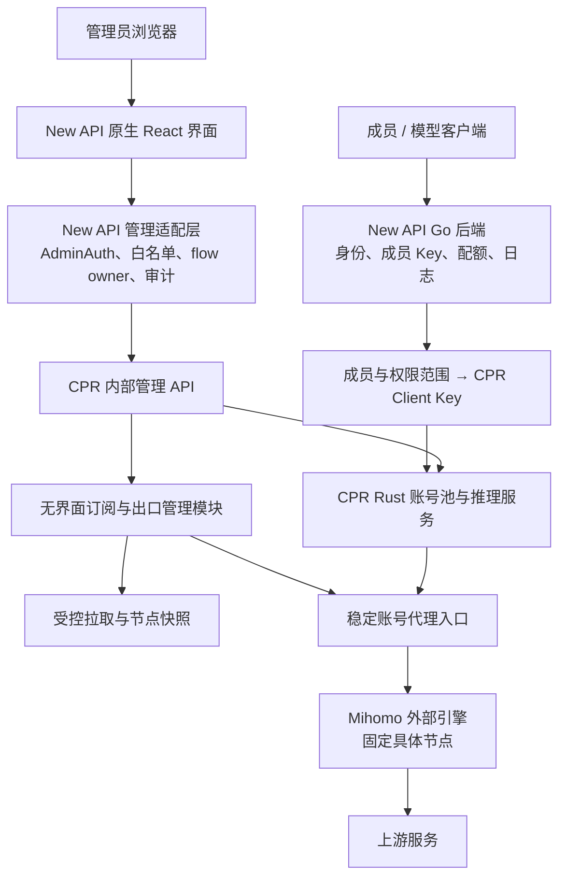

# 架构与可行性

更新：2026-11-22 UTC。结论：**技术方案可行，但需要订阅模块抽离、统一后台适配和固定出口策略，不能靠拼接三个安装包完成。**本页是设计建议；源码证据见 [订阅专题](../research/feasibility-subscription.md)、[后台专题](../research/feasibility-admin-integration.md)、[上游清单](UPSTREAM.md)。没有运行时验收。

## 组件与部署

New API 是唯一产品 Web 入口。管理适配层在现有 Go 后端中实现，不另起一套公网管理服务；CPR 保持独立 Rust 进程，通过内部 HTTP/WS 与 New API 协作。Mihomo 为外部可执行程序，由受控生命周期管理。

首版建议将 Cockpit 可用模块抽成 CPR workspace 内无 Tauri 依赖的库或明确子模块：纯解析、订阅业务、引擎控制分开。最终 crate 名和放置边界在 X02、X06 的源码清单与接口验证后确定。本页没有声称已创建这些 crate。

CPR 原有 `gateway-egress` 只处理出站选择；不将订阅抓取、引擎安装和界面逻辑全塞入该模块。沿用现有 owner：Admin 校验管理操作；Store 保存配置和版本；Host 监督进程和 worker；Provider 使用账号出口；API 暴露合同。首版不依赖实验插件 SDK 的后台执行与生命周期语义实现强制出口，后续确认能力后再考虑插件化。

部署目标固定为 **Linux 单机 Docker Compose**。产品五服务和持久化边界见[部署设计](DEPLOYMENT.md)：Mihomo 是 CPR 容器内的受管进程，New API 与 CPR 在 PG18 中分库分用户、分别使用自己的 Redis。CPR 单副本，公网只暴露 New API 的 HTTPS 入口。本文不要求 Kubernetes、Helm 或云端部署。

## 统一页面

建议在 New API 管理区增加“账号与出口”，包含四个页面，实际路径在 X05、X12 定稿：

| 页面 | 管理员能完成的操作 |
| --- | --- |
| 上游账号 | 列表、额度／状态、分组、并发、启停、刷新、授权、重授权、出口绑定 |
| 节点订阅 | 添加链接、手动刷新、最近成功时间、订阅更新差异、来源启停 |
| 节点与出口 | 节点筛选、可用性、IPv4／IPv6、绑定账号、漂移／缺失提示 |
| 引擎状态 | 版本、健康、配置代次、启动失败原因、受控重启和诊断 |

CPR 是 Vue 管理页，New API 是 React，页面不能直接组件级复制。通过 New API 原有组件重建上述工作流，复用 CPR 管理 API。iframe 可用于临时验证，不作为最终默认：它会引入独立登录、Cookie/CSP、UI 风格与凭据边界问题。不要向浏览器注入 CPR 管理密钥以伪造单点登录。

普通成员保留自己的 Key、配额和用量页面。菜单隐藏和路由 guard 负责体验，服务端角色校验负责授权。

## 管理 API 与授权流程

CPR 的目标管理接口采用 `AdminAuth`，支持 `x-api-key`；个别文档写“管理员会话”不能据此替代源码判定。注册/密码/浏览器会话接口不等同于这些管理业务接口。具体白名单与证据见 [后台专题](../research/feasibility-admin-integration.md)。

BFF 建议白名单：账号列表／详情／分组设置、OAuth start/complete、令牌与额度刷新、连接测试、代理列表／测试／受控绑定，以及新建的订阅和节点操作。只固定映射 method、path、字段和分页，不提供任意上游 URL 或任意 `/api/admin/*` 代理。订阅下载 URL 的校验与内部 CPR 地址配置是不同信任边界。

CPR admin API Key 只在 New API 服务端受保护配置中持有，浏览器使用现有 New API 登录会话。上游 access/refresh token 只留 CPR；普通成员不得得到这些 token。导出凭据、插件安装、系统升级、备份恢复和管理密钥轮换不进入首版管理白名单。

CPR的服务Key调用使用共同AdminApiKey主体，New API持久操作保存管理员ID、登录会话ID及两级认证版本，关联provider、目标账号、固定来源／节点／代理与期限。读取、完成和取消都复核当前会话及authorize权限；完成以数据库单次领取后调用固定CPR端点，Provider继续负责state／PKCE。浏览器回调仅在短期内存和本次POST传递，认证材料留在CPR。

`/api/admin/oauth-operations`提供纯只读完成回执，New API以本地operation归属校验后读取。CPR凭据、专用路由、operation和24小时完成回执同事务提交；查询只在有效回执确认时返回completed，缺失、过期或交换已开始而确认尚缺时返回unknown。BFF响应丢失及重启后只GET恢复，未知操作的兑换保持关闭，管理员显式新授权使用新操作ID。

新账号先生成未来原生accountId，以该owner验证独立入口后开始OAuth。账号保存成功时原子建立proxy及路由绑定，generation为1，沿用入口端口与私有认证，并保存X09路由确认操作供显式对账恢复。过期或明确结束的未知预留可显式取消，回收前核对账号、代理、路由引用；重复取消可补齐外部清理，完成领取事实持续保留。API合同见[授权操作](../services/codex-proxy-rs/docs/api.md#17-管理员托管oauth与只读回执)。

OAuth token exchange 可在服务器经选定出口执行；浏览器首次登录是另一条网络路径。首版由管理员在已配置相同节点代理的授权浏览器中打开链接，并回传授权结果；系统不可声称仅设置服务器代理就保证浏览器 IP 一致。内置远程浏览器或桌面 WebView 为后续可选范围。

## 订阅进入系统的路径

1. 服务端接受管理员提交的订阅来源，保护 URL 中的 token；响应只显示遮蔽来源和内部 ID。
2. 使用有界客户端拉取，每次跳转重新验证 scheme、主机和实际目的地址；默认 HTTPS，受控自建源例外单独配置。不得借订阅请求访问云元数据／任意内网服务，内部本机代理地址由系统生成，不能被同一规则误拒绝。
3. 识别 Clash YAML/JSON 的具体节点、Base64 包装文档、URI 列表和 Base64 URI 列表；HTTP/SOCKS、SS、VMess、VLESS、Trojan 作为首批验证协议，HY2/TUIC 在样本转换及实际传输通过后标记支持；错误逐项报告，不静默丢弃后假装全部导入成功。
4. `proxy-providers` 使用本产品的受控下载器拉取并归一化到具体节点，限制嵌套与资源；不让 Mihomo 继续持有远端 provider 自动更新源。
5. 只提取支持的节点连接字段。原始远程规则、外部控制接口、任意文件路径和可扩展执行内容不直接成为运行配置；生成由本项目拥有的最小 Mihomo 配置。
6. 校验后生成候选快照和差异；完整提交后才激活。下载失败保留最后成功快照并标记过期，成功结果中的节点缺失或连接参数变化按下面规则处理。

Cockpit 的现有原生配置解析可能会启动 Mihomo 检查配置；因此“调用其解析函数”不自动等于安全的纯解析。抽离必须把静态解析、受控 provider 拉取、引擎验证分开。来源与具体限额见 [订阅专题](../research/feasibility-subscription.md)。

## 节点身份与更新语义

| 对象 | 负责的事实 |
| --- | --- |
| SubscriptionSource | 不透明来源 ID、加密／受保护 URL 引用、拉取策略、最后成功状态 |
| SubscriptionSnapshot | 一次成功拉取的版本、摘要、规范化节点和校验结果 |
| NodeIdentity | 本地持久 UUID、来源关联；名称只是展示字段 |
| NodeRevision | 规范化连接参数及内部指纹；秘密变化同样算新版本，指纹不作为公开秘密摘要展示 |
| ManagedEgressRoute | 固定入口端口、所选 node UUID/revision、必须出口策略、期望／实际代次、健康 |
| CPR managed proxy | CPR 原有代理 ID 和系统生成的内部 URL；账号继续使用 outboundProxyId |

CPR 账号的 outboundProxyId 是账号→代理的权威关联；新的 managed route 负责代理→节点版本，不再维护一份可独立写入的账号代理关系。专属路由的账号关联从 CPR 引用计算／校验，新账号授权前可以存在尚未被账号引用的预留路由。

名称或排序变化不改变账号选择。同名但连接参数不同生成新候选版本；匹配不明确时要求显式重绑。节点在成功订阅结果中消失，标记 missing 并停止新增出站，不自动转同名节点、下一节点或默认出口。网络获取失败则保留上次成功配置，允许策略范围内继续原路线，并明显提示陈旧状态；这不等于确认节点仍有效。

管理员主动换节点时先准备新引擎与验证出口，再按选定策略排空旧流和提交新配置。CPR 当前连接池键包含账号和代理 URL；稳定入口 URL 不变时，换节点不会自动使旧 HTTP/2／WS 连接失效。因此需要让连接池感知出口 generation，或确认已阻止新请求并排空／终止旧连接后再发布；不能只更新代理目录 revision。节点缺失后的停发也必须阻止既有连接上的新逻辑请求。不得在旧请求运行时悄悄将它接到别的账号／节点；后台刷新同样受网络策略和配置版本控制。更新失败可回到明确保存的上一成功配置；不创建“未知就直连”的恢复路径。

受管路由修改由 CPR 端的管理用例在自己的事务和期望版本内提交，BFF 不另建可编辑账号绑定。现有账号接口返回的 configRevision 只是已提交事实，不是账号 update 的 CAS 条件；代理 update/delete 使用各自 revision。跨 New API 操作记录、CPR 配置和外部引擎没有单一事务，应以 operation ID、desired/applied/unknown 和读回对账处理响应丢失，避免无条件重试或删除重建。

## 固定出口与进程模型

首版采用每账号稳定本地入口、独立受控引擎的隔离思路。小团队优先降低配置相互影响，待 X08 测量内存/连接开销后确定可支持的账号数量。账号入口默认只接受服务内部连接；管理员授权浏览器需要使用同一入口时，可通过受保护的 SSH／VPN 隧道临时接入，不向公网开放通用代理。

Mihomo 官方支持每个 listener 用 `proxy` 指向具体出站，也支持 mixed HTTP/SOCKS 入口：[通用 listener](https://wiki.metacubex.one/en/config/inbound/listeners/)、[mixed listener](https://wiki.metacubex.one/en/config/inbound/listeners/mixed/)。共享进程多 listener 可降低资源占用，但重载、故障范围和连接排空仍须测试，暂列后续替代，不与首版并行实现。

生成配置只指向明确节点，不使用自动选择、load-balance、fallback 或 DIRECT 回退。Mihomo 的探测控制 API、下载目录和配置文件只能由受控服务访问；版本固定并核验制品，不执行订阅提供的安装命令。

必须出口的账号要在所有相关网络发送前得到明确的允许／拒绝决定。CPR 原有逻辑把被禁用代理投影为无代理，进而使用环境代理或直连；必须修改该语义或新增明确策略。仅在 UI 禁止删除代理或只把 account.enabled 设为 false 不够：后台 refresh 仍可能继续执行。

出口漂移检测是观测，不是对每个后续上游连接的原子保证。若供应商采用动态出口，严格固定公网 IP 无法由本系统独立保证；需固定 IP 节点服务。DNS、IPv6 和代理控制流也需在真实环境验证。

## 成员数据面

New API 使用普通 OpenAI compatible 渠道连接 CPR，内部 URL 为服务根地址，客户端路径保留 `/v1/responses`；WS 单独启用。渠道 Proxy 只控制 New API→CPR，不负责 CPR→上游节点。

New API 已认证的成员/权限范围映射到独立 CPR Client Key。映射由服务端选择，不使用客户端自报 user/session；撤销、改组与创建可幂等对账。CPR Key 的明文留服务端，前端用户拿到的是 New API Key。下游同名 session、previous_response_id 必须跨用户隔离测试。

用量与成员配额由 New API 负责，CPR 用量主要反映账号容量和诊断。没有支付要求不代表可以省略并发、额度和异常计量。首版限定外层重试，账号恢复由 CPR 负责；已输出流和副作用不做无依据重放。

## 可行性判断与关键阻点

| 部分 | 判断 | 需要新增或验证 |
| --- | --- | --- |
| New API 统一界面 | 可行 | React管理页面、Go BFF、角色/flow owner保护 |
| CPR账号OAuth与管理 | 已有基础 | API合同实测、管理审计关联、预留出口和账号关联 |
| Clash订阅读取 | Cockpit有实现可借鉴 | 去Tauri、受控provider读取、静态解析、版本快照 |
| 固定账号出口 | CPR与Cockpit都有基础 | 禁止默认回退、全链路后台覆盖、稳定节点身份 |
| 不同公网IP | 依赖节点服务 | 实测双栈和漂移，无法凭节点名或端口证明 |
| 跨agent持续工作 | 文档机制可落地 | 依赖执行者按启动/收工约定维护；不是自动保证 |

实施进度和 GitHub 同步状态以[状态表](STATUS.md)为准，业务源码基线从 X02 开始。真实格式兼容、平台容量、登录浏览器代理和全链路失败行为仍需按 [验收矩阵](VALIDATION.md)确认。
