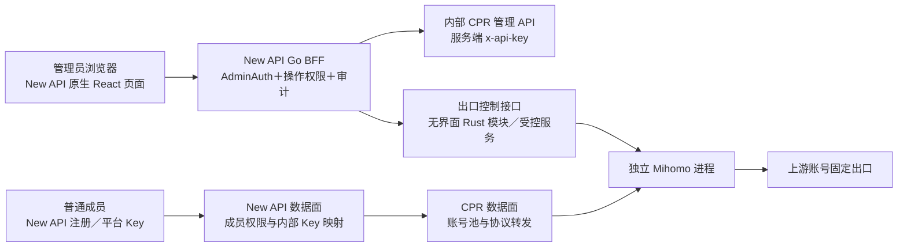

**New API 统一管理员后台与 CPR 集成可行性**

> 历史研究，保留原审查时点和结论。当前开发任务以[单机 Docker 计划](../docs/PLAN.md)为准；原 P 编号见[历史对照](../docs/PLAN.md#legacy)。

本报告对应最新范围：朋友小团队非商业自用；New API 是唯一产品界面和成员身份入口；只有管理员可以授权和管理上游账号、Clash 订阅／节点及账号出口；普通成员注册、创建或获得平台 Key 后使用模型。不建设支付、售卖套餐或商业履约流程。

核查方式为已有源码快照的静态阅读；没有启动、构建或执行第三方项目，没有导入真实账号或订阅，没有修改业务源码。报告只写入本文件。时间采用本次核查日 2026-11-22 UTC。

固定基线：

| 项目 | 本次审查提交 | 固定公开源码 |
| --- | --- | --- |
| New API | [8542c9d6490b4330fe18160930f81ae7428bc777](https://github.com/QuantumNous/new-api/commit/8542c9d6490b4330fe18160930f81ae7428bc777) | [New API 源码树](https://github.com/QuantumNous/new-api/tree/8542c9d6490b4330fe18160930f81ae7428bc777) |
| codex-proxy-rs（下文 CPR） | [58cbb607505dda4a1cee6e01b9f76e267ad3c261](https://github.com/zyycn/codex-proxy-rs/commit/58cbb607505dda4a1cee6e01b9f76e267ad3c261) | [CPR 源码树](https://github.com/zyycn/codex-proxy-rs/tree/58cbb607505dda4a1cee6e01b9f76e267ad3c261) |

**推荐：原生 React 管理页面＋New API 服务端 BFF，CPR 继续作为独立 Rust 进程**

这条路线实际可实施。CPR 已有账号、OAuth、Client Key、分组和普通代理的管理 API，New API 已有管理员路由、服务端角色检查、细粒度权限和审计入口。需要新增的是两者的适配、可信身份归属、出口控制编排和界面；不需要把 CPR 的 Rust 网关重写成 Go，也不需要把 Vue 整站嵌入 React。

BFF 是 New API 后端新增的一组窄业务接口，可直接放在现有 Go 进程内；它持有内部 CPR 地址与管理凭据，将 React 需要的 DTO、错误和流式进度进行转换。CPR 仍管理上游凭据、刷新、账号状态和调度。Clash 节点控制提炼为无界面模块并调用外部 Mihomo；其接口与实现由出口模块负责，不在本报告中冒充已有 CPR API。

内网通信不等于自动可信：公网只暴露 New API；CPR 和 Mihomo 管理端口只允许实际调用方访问。BFF 使用固定内部目标，不接受浏览器指定 host、port、任意 URL、任意 CPR 路径或任意请求头。

**三种 UI 路线比较**

| 路线 | 能复用什么 | 主要代价与边界 | 结论 |
| --- | --- | --- | --- |
| New API 原生 React 页面＋BFF | New API 布局、身份、权限、表格、表单和交互；CPR 稳定管理 API | 需要重建本功能需要的 React 页面、DTO 和 BFF；需要维护 API 合同测试 | 长期推荐；符合统一产品 UI 与成员隔离要求 |
| iframe 载入 CPR Vue 管理站 | 最快复用完整 CPR 页面 | 两套路由、主题、状态和错误；仍需解决 CPR 独立登录、Cookie、跨域／嵌入策略；New API 登出或降权不会天然撤销 CPR 会话 | 仅作为内部临时工具验证可考虑；不作为正式统一后台 |
| 外链／双登录 | 不改 CPR UI，运维成本初期低 | 管理员需记两套身份；普通成员若可直达 CPR，必须另行阻断；操作审计和撤权分裂 | 可保留为受限应急运维入口，不是产品主流程 |

iframe 不能自动获得“统一鉴权”。将 CPR admin key 塞到 URL、localStorage、前端环境变量或 postMessage 都会扩大密钥暴露；在反代上给整个 CPR 站点无条件注入管理 key，则会把可访问该反代的人都提升为 CPR 管理员。即使保留 iframe，也必须逐请求验证 New API 管理员身份和操作权限；同时仍需适配 HTML 资源、绝对路径、Cookie 和 API 路由，已接近另做一套复杂网关。本轮没有运行浏览器，未确认 CPR 的 frame-ancestors／X-Frame-Options／跨站 Cookie 实际行为。

技术栈确有差异：[New API 前端依赖](https://github.com/QuantumNous/new-api/blob/8542c9d6490b4330fe18160930f81ae7428bc777/web/package.json#L26-L110)是 React 19、TanStack Router／Query／Table、Zustand、Base UI、Tailwind 4、Rsbuild，包管理为 Bun；[CPR 前端依赖](https://github.com/zyycn/codex-proxy-rs/blob/58cbb607505dda4a1cee6e01b9f76e267ad3c261/frontend/package.json#L1-L58)是 Vue 3、Vue Router、Pinia、Vue I18n、Vite 和 pnpm。CPR 的 Vue 单文件组件不能直接当作 New API React 组件导入。可以参考字段、交互和接口合同，避免整体搬入第二个前端运行时。

**New API 现有入口与需要新增的位置**

[管理员菜单](https://github.com/QuantumNous/new-api/blob/8542c9d6490b4330fe18160930f81ae7428bc777/web/src/hooks/use-sidebar-data.ts#L132-L188)已集中在 admin 分组；[菜单过滤](https://github.com/QuantumNous/new-api/blob/8542c9d6490b4330fe18160930f81ae7428bc777/web/src/hooks/use-sidebar-view.ts#L61-L72)按角色显示。现有[渠道页面路由](https://github.com/QuantumNous/new-api/blob/8542c9d6490b4330fe18160930f81ae7428bc777/web/src/routes/_authenticated/channels/index.tsx#L19-L48)用 TanStack Router 的 beforeLoad 检查管理员角色。这些是页面导航与体验层，不构成后端授权。

服务端必须复用真实的[AdminAuth](https://github.com/QuantumNous/new-api/blob/8542c9d6490b4330fe18160930f81ae7428bc777/middleware/auth.go#L52-L176)：解析有效 dashboard 身份，检查用户启用状态及最低管理员角色。该版本 dashboard 请求使用 Authorization 中的访问令牌，内部登录令牌会验证实际登录会话；它并非简单根据一个前端 role 字段或 Cookie 是否存在判断身份。PAT 还有自己的路由 scope 检查。

现有[渠道路由注册模式](https://github.com/QuantumNous/new-api/blob/8542c9d6490b4330fe18160930f81ae7428bc777/router/channel-router.go#L20-L54)叠加 AdminAuth 和 RequirePermission，并声明 PAT 所需权限；[RequirePermission](https://github.com/QuantumNous/new-api/blob/8542c9d6490b4330fe18160930f81ae7428bc777/middleware/auth.go#L410-L419)使用服务端 userID、role 调用 authz.Can。现有[权限资源定义](https://github.com/QuantumNous/new-api/blob/8542c9d6490b4330fe18160930f81ae7428bc777/service/authz/resources_channel.go#L3-L55)可作为新增 codex／egress 权限的模式，不必再建另一套角色系统。

建议新增的逻辑位置如下，均为设计项，尚未创建：

| 层 | 建议位置／职责 |
| --- | --- |
| React 路由 | `web/src/routes/_authenticated/upstreams/`，beforeLoad 检查管理员，并根据权限控制功能入口 |
| React 功能 | `web/src/features/upstream-accounts/`、`web/src/features/egress/`；复用现有 data-table、dialog、confirm-dialog、空／错／加载状态、React Query 与表单组件 |
| BFF 路由 | 在现有 API router 注册 `/api/admin/codex/*`、`/api/admin/egress/*`，统一 AdminAuth，再按读／操作／敏感写权限分配 |
| Go 服务适配 | 独立 CPR client、DTO 转换和有界调用；OAuth flow owner、内部 Key 映射、出口操作状态属于各自业务服务 |
| 权限定义 | 在现有 authz registry 增加资源和动作；普通成员全部拒绝，管理员按授权获得所需动作 |
| CPR 修改 | 只补全链路出口停发／严格绑定等现有能力缺口；其余尽量通过现有 API 集成 |

最小权限建议：账号列表／状态读取、账号测试／刷新、账号授权／删除、节点读、节点订阅与绑定写分别授权；CPR 地址、管理 secret、Mihomo 控制地址与进程管理只由 root／部署运维控制。小团队可让少量管理员同时拥有这些权限，但不要因此把权限检查删除。普通成员的模型平台 Key 不能调用这些 BFF 管理接口；不要使用 TokenOrUserAuth 作为管理接口的替代。

敏感二次验证可复用 New API 的 RequireSecurityProof 机制，但现有 [SecureVerificationRequired](https://github.com/QuantumNous/new-api/blob/8542c9d6490b4330fe18160930f81ae7428bc777/middleware/secure_verification.go#L15-L79)专门绑定 channel-key-read 上下文，不能不改 scope 直接套在账号导出、上游授权或节点凭据查看上。MVP 不提供上游 token 导出／节点密钥明文查看，减少不必要的敏感接口。

**CPR 管理 API：MVP 白名单可复用哪些**

CPR 的 [AdminAuth 提取器](https://github.com/zyycn/codex-proxy-rs/blob/58cbb607505dda4a1cee6e01b9f76e267ad3c261/backend/crates/gateway-api/src/admin/auth.rs#L16-L108)先验证 `x-api-key`，成功得到 AdminPrincipal::ApiKey；未提供该头时才验证 CPR 管理员会话。它是部署级管理权，不是本功能的细粒度 scoped key。因此 BFF 的 API 白名单和权限检查是必要边界。

| 目标功能 | CPR 已有接口 | BFF 处理／限制 |
| --- | --- | --- |
| 账号列表／详情／状态 | `GET /api/admin/accounts`、`/detail`、`/quota` | 返回显示所需字段；不回传 token、原始 credential JSON、代理认证信息 |
| 授权／重新授权 | `POST /api/admin/accounts/oauth/start`、`/oauth/complete` | 加本地管理员 flow owner、权限、过期与幂等控制 |
| 账号编辑／启停／出口绑定 | `POST /api/admin/accounts/update`、`/batch-update` | 校验账号、分组和受管出口；不开放 arbitrary connection/provider 配置 |
| 测试／额度刷新／令牌刷新 | `GET /api/admin/accounts/connection-test`；`POST /quota/refresh`、`/refresh` | 进度可用同源有鉴权 fetch 流返回；限制并发、大小和时长，错误详情再裁剪 |
| 删除账号 | `POST /api/admin/accounts/delete` | 敏感写权限、确认和本地操作审计；处理内部分组／映射影响 |
| 普通代理列表／创建／更新／探测 | `GET /api/admin/proxies`、`/proxies/accounts`；`POST /create`、`/update`、`/test`、`/probe` | 受管代理 ID、字段白名单；节点管理模块产生的端口必须与受管记录对应 |
| 分组与内部 Client Key | `/api/admin/account-groups/*`、`/api/admin/client-keys/*` | 仅给服务端成员映射／运维使用；不对普通成员透传 CPR 管理 API |
| Clash 订阅／节点／Mihomo 控制 | CPR 无上述现成合同 | 需要独立出口模块和 BFF 专用接口；不能把普通代理 CRUD 说成 Clash 管理已完成 |

实际账号路由和 handler 均可由固定[账号处理器](https://github.com/zyycn/codex-proxy-rs/blob/58cbb607505dda4a1cee6e01b9f76e267ad3c261/backend/crates/gateway-api/src/admin/accounts/handlers.rs#L14-L78)追踪，OAuth start／complete [明确接收 AdminAuth](https://github.com/zyycn/codex-proxy-rs/blob/58cbb607505dda4a1cee6e01b9f76e267ad3c261/backend/crates/gateway-api/src/admin/accounts/handlers.rs#L202-L247)。[代理路由](https://github.com/zyycn/codex-proxy-rs/blob/58cbb607505dda4a1cee6e01b9f76e267ad3c261/backend/crates/gateway-api/src/admin/proxies.rs#L247-L280)与创建／更新同样使用 AdminAuth。

文档中个别地方写“需要管理员会话”，不能据此推断排斥管理 key。本快照的[账号并发查询](https://github.com/zyycn/codex-proxy-rs/blob/58cbb607505dda4a1cee6e01b9f76e267ad3c261/backend/crates/gateway-api/src/admin/accounts/concurrency.rs#L48-L65)、[个人信息与头像](https://github.com/zyycn/codex-proxy-rs/blob/58cbb607505dda4a1cee6e01b9f76e267ad3c261/backend/crates/gateway-api/src/admin/accounts/handlers.rs#L408-L445)也使用 AdminAuth，实际接受 admin key；头像并发明细不是 MVP 必需，可暂不接。此结论不扩展到 CPR 自己的登录／会话／改密接口；统一产品不需要代理这些接口。

明确不做通用 `/cpr/*` 透明管理反代。MVP 不映射 CPR admin-key 生成／删除、账号凭据导出、插件安装、在线更新／重启、数据库备份恢复、任意上游 URL 操作和原始请求转储。需要后续扩展时按具体功能逐项授权。

**OAuth：三种身份与 flow owner 必须分开**

1. New API 管理员身份：谁有权把上游账号加入团队池、修改出口；由 New API 的有效会话和权限判定。
2. CPR BFF 服务身份：Go 服务调用 Rust 管理 API 的部署级管理 key；不能传到浏览器。
3. ChatGPT 上游身份：管理员在 OpenAI 授权页面登录的账号；最终解析到的用户／工作区／套餐，不等于 New API 管理员，更不赋予普通团队成员后台权限。

当前 CPR 的[管理主体模型](https://github.com/zyycn/codex-proxy-rs/blob/58cbb607505dda4a1cee6e01b9f76e267ad3c261/backend/crates/gateway-admin/src/model/auth.rs#L14-L47)将所有 API-key 请求映射为 MutationActor::AdminApiKey。[OAuth owner 绑定](https://github.com/zyycn/codex-proxy-rs/blob/58cbb607505dda4a1cee6e01b9f76e267ad3c261/backend/crates/gateway-admin/src/model/provider_credentials.rs#L137-L186)与[OpenAI owner hash](https://github.com/zyycn/codex-proxy-rs/blob/58cbb607505dda4a1cee6e01b9f76e267ad3c261/backend/crates/providers/openai/src/credential/oauth.rs#L834-L844)均不会区分各个 New API 管理员。给请求附一个客户端可伪造的 X-User-ID 不会改变这个事实，也不应被当成可信授权。

建议 BFF 流程：

- 管理员先选择已准备好的固定出口，再在同一 New API 管理页点击“授权上游账号”。BFF 检查登录会话、角色、敏感写权限和当前账号／代理状态，调用 CPR start。
- CPR [start 请求字段](https://github.com/zyycn/codex-proxy-rs/blob/58cbb607505dda4a1cee6e01b9f76e267ad3c261/backend/crates/gateway-api/src/admin/accounts/credentials.rs#L114-L163)是 provider、name、可选 accountId、outboundProxyId；complete 是 provider、flowId、callbackUrl、可选 settings。重授权的目标账号在 start 时已绑定，complete 不应允许更换目标。
- BFF 保存 `opaqueOperationId → NewAPI adminUserId＋sessionId＋provider＋CPR flowId＋目标账号＋代理ID/版本＋expiresAt＋operation state`。这些是服务端数据。前端只获得授权 URL、有效期、操作 ID 和必要说明。
- 管理员在 OpenAI 页面完成登录后，将完整回调 URL 粘贴回 New API 的授权弹窗。这个 MVP 直接复用 CPR 已有[手动回调交互](https://github.com/zyycn/codex-proxy-rs/blob/58cbb607505dda4a1cee6e01b9f76e267ad3c261/frontend/src/views/accounts/composables/useAccountAuthorization.ts#L57-L113)，无需假设能随意更换官方 OAuth redirect URI。
- BFF complete 重新检查会话仍有效、权限仍在、操作归当前管理员、未过期且目标未变。按操作串行处理，随后向 CPR 转交回调材料，由 CPR 继续做 PKCE、state 和 token exchange；BFF 不自行兑换 token，不把 callback URL 当作待抓取网页。
- 完成后读取账号结果并展示真实上游邮箱／工作区，帮助管理员确认授权的是预期账号。New API 自己登录了哪个账号，不会强迫 OpenAI 浏览器会话选择相同邮箱。
- 本地审计记录 New API actor、动作、目标、结果和 requestId；CPR 审计仍显示 AdminApiKey。通过 BFF 生成的 requestId 关联两端，不记录 code、AT／RT、完整回调 URL、管理 key 或订阅 URL。

CPR 已有[完成回执流程](https://github.com/zyycn/codex-proxy-rs/blob/58cbb607505dda4a1cee6e01b9f76e267ad3c261/backend/crates/gateway-admin/src/use_case/credentials/flow.rs#L202-L265)，账号提交后的同 flow 完成结果保留 24 小时；[回执 owner digest](https://github.com/zyycn/codex-proxy-rs/blob/58cbb607505dda4a1cee6e01b9f76e267ad3c261/backend/crates/gateway-admin/src/model/provider_credentials.rs#L481-L534)中 admin-api-key 也共用身份。因此 BFF 必须在读取或重试已完成结果时同样做本地 owner 检查，不能把上游幂等当成跨管理员隔离。

CPR 的[OAuth 合同](https://github.com/zyycn/codex-proxy-rs/blob/58cbb607505dda4a1cee6e01b9f76e267ad3c261/docs/api.md#L1749-L1794)还区分“未能连接”和“结果未知”。对 50202 或 token exchange 成功但提交不明，不能自动创建新 flow 或无条件重放一次性授权码；BFF保留未知状态并查询自己的操作记录和当前账号，必要时提示重新授权。当前核查的公开路由没有独立 OAuth flow／receipt 查询接口：CPR 回执是 complete 内部的重试恢复机制，不能伪写成 BFF 可直接 GET 的现成接口。本轮集成计划已选择新增窄的只读完成回执查询合同（尚未实现）：已有确认回执才返回completed，缺失或过期保持unknown，不执行token exchange。BFF按原operation并重检owner恢复；账号列表只作诊断，不作为该flow已完成的证明。P0-02冻结合同，P3-01实现并验证提交成功后响应丢失及BFF重启；详见[主架构](../docs/ARCHITECTURE.md#管理-api-与授权流程)。关闭页面不代表后台请求没执行。

浏览器第一次访问 OpenAI 授权页的出站 IP，由管理员浏览器／系统网络决定；CPR outboundProxyId 约束的是服务端 exchange、refresh 和 API 请求。如果要求首次网页登录与后续请求同出口，需管理员显式通过该出口使用授权浏览器，或后续单独建设受控授权工作站。本方案不自动远控管理员浏览器，也不宣称服务端代理能改变浏览器出口。

**账号出口修改与一致性**

不能在两个服务中各保存一份可独立编辑的账号出口事实。CPR 的账号→outboundProxyId 是执行事实；出口模块保存节点→稳定端口／引擎配置事实；BFF保存跨服务 operation、映射和 desired/applied 状态，用来协调和解释失败。

[CPR 一致性合同](https://github.com/zyycn/codex-proxy-rs/blob/58cbb607505dda4a1cee6e01b9f76e267ad3c261/docs/api.md#L199-L205)明确：账号更新返回的 configRevision 是已提交事实，不是账号写入的 CAS 前置条件；代理 update／delete 使用资源自身 revision；整体运行设置才要求 configRevision。不得把全部请求都套一个“传 configRevision 就防并发”的假合同。

建议受管出口更新步骤为：记录操作和期望版本 → 生成并验证新内核配置／稳定入口 → 验证入口准备成功 → 对 CPR 代理按 revision 更新，必要时更新账号绑定 → 读回确认 CPR 当前绑定和 revision → 标记 applied。跨 Go DB、CPR DB 和 Mihomo 无单一事务；超时保留 pending／unknown，按已提交事实对账，不盲目全量重试、删除重建代理或重复兑换凭据。

[代理 API](https://github.com/zyycn/codex-proxy-rs/blob/58cbb607505dda4a1cee6e01b9f76e267ad3c261/docs/api.md#L1443-L1542)存在批量部分成功、revision 冲突、导入期间资源保护等语义，BFF应保留逐项结果。OAuth 待回调期间代理可能变化，提交时还会复核代理身份／状态；此时应重新发起有效授权，不静默把 flow 迁往另一个出口。

严格停发仍需 CPR 的统一出站约束。当前[账号停用合同](https://github.com/zyycn/codex-proxy-rs/blob/58cbb607505dda4a1cee6e01b9f76e267ad3c261/docs/api.md#L1803-L1807)明确 enabled 只停止请求调度，停用账号仍会自动刷新令牌；[账号出口合同](https://github.com/zyycn/codex-proxy-rs/blob/58cbb607505dda4a1cee6e01b9f76e267ad3c261/docs/architecture.md#L1051-L1078)说明禁用代理后会使用部署默认出口，已有连接可继续旧出口。因此，“先 disabled 账号，再关代理／切节点”不足以保证无流量或出口不变。

必须新增并验证账号全链路 egress blocked／required 策略：覆盖推理、refresh、exchange、quota、catalog、profile 等出站，并明确在途连接是完成后切换还是主动排空。需要严格切换时，由 CPR／出口层确认新请求及后台任务已阻止、在途操作达到约定边界后再切换。BFF 的本地锁只能约束经 BFF 发起的并发，无法替代 CPR 后台 worker 的网络准入。控制点和完整生命周期由出口专项报告进一步定义。

**普通成员与内部 Key 映射**

成员继续使用 New API 的注册、登录、自己的平台 Key 和自己的用量界面。小团队可以保留并发、额度和模型范围控制，但无需支付页面／购买流程。成员的 Key、CPR 的内部 Client Key、CPR 管理 key、上游 OAuth token 是四类独立凭据。

New API 普通渠道会用静态渠道 Key 替换上游 Authorization；[该实现](https://github.com/QuantumNous/new-api/blob/8542c9d6490b4330fe18160930f81ae7428bc777/relay/channel/openai/adaptor.go#L192-L240)不会自动映射成员身份。CPR 的[会话／续接范围](https://github.com/zyycn/codex-proxy-rs/blob/58cbb607505dda4a1cee6e01b9f76e267ad3c261/docs/architecture.md#L695-L748)按 Client Key 隔离。即使不收费，全部成员共享同一个 CPR Key 也会合并 CPR 看到的主体，不能承诺成员会话和后端限额隔离。

长期方案为 New API 服务端按 `memberId＋授权范围`选择稳定内部 CPR Key，并与允许的账号组对应；成员换平台 Key时可按产品规则保留或撤销内部身份。创建／回收内部 Key通过服务端窄 provisioning 操作完成，普通成员不能指定 CPR Key、账号ID或代理ID。映射创建要防并发重复；成员封禁／权限收回后，新请求以及既有 WebSocket 的后续轮次应验证失效语义。内部 Key只在服务端保存并轮换，不发给浏览器作为第二个可绕开 New API 的入口。

**本功能相关的密钥与 SSRF 边界**

- CPR admin secret 从部署 secret 或受保护配置加载，后端 UI 最多返回 configured／最后轮换时间；不进入前端构建变量、页面、日志或错误对象。CPR现有管理 key权力较宽，MVP通过内部网络和BFF白名单收窄；真正CPR端 scoped management key是可选后续能力，当前未实现。
- OAuth 的 AT／RT归 CPR。BFF只转交短期 code／callback 材料并及时清理，不重复保存上游 token。CPR当前持久化凭据仍是 Provider 明文 JSON，不能宣称已加密；部署保护及未来静态加密按敏感数据处理。
- Clash订阅URL常含访问token，节点配置可能含密码／UUID。仅管理员可写，普通列表返回脱敏URL／hasSecret／更新时间；不得返回原始YAML、完整连接串或订阅响应，错误正文也要脱敏。订阅下载与普通代理连接是不同动作。
- BFF到CPR和出口控制端使用部署固定目标，允许明确的内部私网地址。远程Clash订阅下载仅允许本功能批准的HTTP(S)来源（生产优先HTTPS），限制重定向、响应大小、超时、条目数和解析复杂度；不支持file、gopher或任意本机路径。每次重定向和最终拨号复查目标，阻止云元数据、回环和非批准内网；需要内网订阅时使用显式窄白名单，而非全局放开private IP。
- New API现有[出站客户端分工](https://github.com/QuantumNous/new-api/blob/8542c9d6490b4330fe18160930f81ae7428bc777/service/http_client.go#L154-L171)区分固定operator目标和可控URL抓取；后者有[受保护fetch与重定向／拨号检查](https://github.com/QuantumNous/new-api/blob/8542c9d6490b4330fe18160930f81ae7428bc777/service/protected_fetch_client.go#L62-L112)。可以参考或复用，但不能未经接线就认为新增Clash下载自动受到保护；全局关闭SSRF或经远程代理解析DNS时还有不同边界。订阅下载发生在Rust出口模块时，应在该模块落实等价控制。
- 不把下载的Clash完整配置原样当Mihomo管理配置执行：只取受支持节点／组字段，由受控生成器决定监听地址、端口、external-controller、secret、TUN、DNS和provider加载行为，避免订阅内容反向改写控制面或触发额外任意下载。Mihomo controller secret不发给浏览器。
- 授权URL由固定Provider生成，浏览器打开前校验预期scheme／host；callbackUrl只作为code/state载体转交，不进行HTTP抓取。普通成员即使手工构造这些字段也应在BFF鉴权阶段被拒绝。

**建议的信息架构与阶段**

管理员新增一个“上游与出口”入口，内部包含：账号概览／账号列表，授权弹窗与重授权，账号组，Clash订阅与节点，账号出口绑定，操作记录。列表显示账号状态、额度观察时间、绑定出口、出口IPv4／IPv6、近期错误和进行中的操作；任何unknown／pending与已生效明确区分。管理key、AT／RT、完整订阅URL不作为常规列。

普通成员继续使用“我的Key、可用模型、我的用量、个人设置”；不请求上游账号列表或Clash接口。若移除付费入口，使用既有导航配置和明确后端开关控制相应功能，不能把隐藏页面当成接口关闭；本轮不扩大为重写计费底层。

| 阶段 | 已有基础 | 需新增 | 可交付验收 |
| --- | --- | --- | --- |
| A. 管理只读页 | React管理路由、AdminAuth；CPR账号／代理读取 | 原生页面、BFF白名单、DTO裁剪 | 成员直接请求所有新管理API被拒绝；管理员可读但无秘密泄漏 |
| B. 管理员OAuth | CPR start／complete、PKCE、完成回执 | 本地flow owner、操作记录、原生授权弹窗 | 跨管理员、降权、过期、并发提交被正确处理；重试不重复兑换 |
| C. 账号和节点操作 | CPR账号／普通代理CRUD；外部内核另行管理 | headless出口控制接入、节点及订阅页面、revision对账、网络停发策略 | 更新失败保留明确状态；停用／删除／重启不发生意外直连；后台刷新也覆盖 |
| D. 成员使用 | New API平台Key和数据面；CPR Client Key | 成员到内部Key映射、权限同步 | 两成员同名session/thread/cache key不串作用域；无权限使用管理接口或直连CPR |

验证缺口：没有运行上述权限请求、OAuth实际授权、浏览器UI、SSE或WebSocket；没有验证Mihomo订阅下载、DNS／SSRF、进程生命周期和出口IP；没有做并发／重启恢复测试。后续至少覆盖未登录、普通成员、只读管理员、可操作管理员、已撤销会话／权限、平台Key、PAT几类身份，且检查HTTP状态与是否发生上游调用；前端隐藏菜单不算服务端测试通过。需要验证的关键失败场景是OAuth结果未知、代理revision冲突、CPR提交成功但BFF响应丢失、Mihomo更新失败、账号disabled后后台刷新仍执行、既有WS在成员撤权后的行为。

本结论回答的是架构和最小可实施范围，未把“存在接口”视为已经集成成功。保留两套独立进程和数据权威，通过窄API统一界面，是当前源码基础上成本与可维护性更合适的长期路线。
