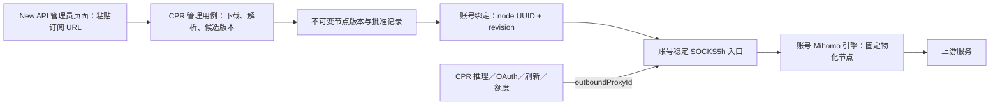

**Clash 订阅导入与账号固定出口：Cockpit → codex-proxy-rs 抽离可行性**

> 历史研究，保留原审查时点和结论。当前开发任务以[单机 Docker 计划](../docs/PLAN.md)为准；原 P 编号见[历史对照](../docs/PLAN.md#legacy)。

核查日期：2026-11-22。使用场景已按用户澄清更新为朋友小团队非商业自用；Cockpit 可以作为复用来源。本报告只核查公开源码和已有本地副本，没有运行仓库程序、Mihomo、测试、真实订阅或真实账号请求，也没有修改共享源码。

固定版本：Cockpit Tools [c004bf71be250cc2536fc91ef90638837f0013a0](https://github.com/jlcodes99/cockpit-tools/commit/c004bf71be250cc2536fc91ef90638837f0013a0)，宿主 1.4.2，固定 Mihomo 1.19.33；CPR [58cbb607505dda4a1cee6e01b9f76e267ad3c261](https://github.com/zyycn/codex-proxy-rs/commit/58cbb607505dda4a1cee6e01b9f76e267ad3c261)。下文“已实现”表示读到实际代码，“建议新增”表示目标设计，“待 POC”表示未以运行证据确认。

**结论**

可以实现“粘贴 Clash 订阅 URL → 拉取节点 → 为每个账号手选固定节点 → CPR 全部账号请求走该出口”。Cockpit 中最有复用价值的是订阅下载、URI 兼容解析、节点配置转换、引擎安装验证、每账号引擎租约及稳定端口的设计。CPR 已有账号 outboundProxyId、HTTP／SOCKS 出站、OAuth／刷新／额度出站上下文，保留其账号池和请求引擎即可。

但不能把 Cockpit 现有模块整体复制后就宣布“固定出口已经完成”。有三个与目标直接相关的差异：

1. 节点 ID 主要由显示名称生成，不是连接配置指纹；同名更换服务器或凭据仍可得到同一 ID。
2. 完整 Clash YAML 走原生 Mihomo profile 路径，原生 proxy-provider 会保留刷新行为。账号绑定了旧 profile 快照，也不能证明其中 provider 的同名节点定义永远不变。
3. Cockpit 的解绑／明确禁用代理、CPR 的禁用／删除代理，都存在回到默认网络或直连的语义。小团队的固定出口模式应把这些动作改成停止相关出站，保留绑定事实等待管理员处理。

首版建议采用“节点物化快照＋每账号独立引擎＋每账号稳定代理入口”，仅开放具体叶子节点选择。共享单进程、多 listener 是后续资源优化候选，不应在抽离初期同时替换生命周期模型。

首版格式边界建议明确为：支持含 `proxies` 的 Clash YAML／JSON、其 Base64 包装、逐行 URI 及 Base64 URI 列表；具体协议从 HTTP／SOCKS5、SS、VMess、VLESS、Trojan 开始，HY2／TUIC 只有在抽离转换和实际环境 POC 后标记可用。HTTP 型 proxy-provider 由受控 Fetcher 限定总字节、资源数量、跳转与递归深度后拉取，循环引用拒绝，再 flatten 成具体节点；内联 provider payload 可同样物化。文件型 provider、任意本地证书路径、完整 PROFILE／rules 模式、自动策略组、外部脚本和 UI 不进入 MVP。需要 dialer 链的节点只有依赖闭包全部可物化时才允许，否则明确标记不支持。运行期引擎配置中不保留 provider URL、刷新 interval 或远端规则。此边界是建议新增，不代表 Cockpit 当前按这个限制工作。

**订阅 URL 的实际支持范围**

| 项目 | 已实现的行为 | 目标设计需要注意 |
| --- | --- | --- |
| 顶层 URL | HTTP／HTTPS，最长 8192 字节，禁止控制字符，必须有 host | 当前未限制公网／内网目标，未禁止 HTTPS 降级或跨域跳转；服务端版本需要逐跳校验 |
| 拉取 | GET，UA 为 `clash.meta/CockpitTools`，不附账号认证头或 Cookie，不用在线订阅转换器 | UA 影响供应商输出协议；可以保留兼容 UA，但应用标识改为实际派生项目 |
| 超时与容量 | 连接 8 秒、单次请求 30 秒；整个可取消导入／刷新事务 45 秒；下载并发 4；响应最多 2 MiB，按 Content-Length 和读取 chunk 双重约束；必须为 UTF-8 | 原生 provider 的后续下载不自动继承顶层 2 MiB 限制，须另设预算 |
| 跳转 | 最多跟随 10 次；每次重新验证为 HTTP／HTTPS | `_origin` 参数未用于同源约束；不要宣称已有同源跳转保护 |
| 鉴权 | URL 原样包含路径／query，可承载供应商订阅 token；URL userinfo 未被校验拒绝；没有发现顶层订阅的自定义 Authorization／Cookie／header 配置入口 | userinfo 实际 Basic Auth 行为由 reqwest 决定，本轮未做验证；需自定义 header 的供应商应新增显式受保护的 auth 配置，不借用账号 token |
| 失败 | 401／403 区分为下载拒绝，TLS／DNS／超时有固定错误类别，不向日志或 UI 输出 URL、正文或原错误链 | 保持脱敏；不要把含 token 的 URL 写入请求日志 |
| 名称／用量 | 解析 profile-title、Content-Disposition 和 subscription-userinfo 的数字字段 | 原始响应头不作账号绑定依据；流量额度与 ChatGPT 额度分开 |

证据：[下载、URL、跳转与读取限制](https://github.com/jlcodes99/cockpit-tools/blob/c004bf71be250cc2536fc91ef90638837f0013a0/src-tauri/src/modules/codex_proxy_catalog.rs#L956-L1108)、[解析分流与 45 秒事务](https://github.com/jlcodes99/cockpit-tools/blob/c004bf71be250cc2536fc91ef90638837f0013a0/src-tauri/src/modules/codex_proxy_catalog.rs#L1111-L1199)、[全局容量](https://github.com/jlcodes99/cockpit-tools/blob/c004bf71be250cc2536fc91ef90638837f0013a0/src-tauri/src/modules/codex_proxy_catalog.rs#L28-L37)。

格式依据正文识别，没有看到依赖 Content-Type 才决定格式的要求：

| 内容格式 | 已核实的处理 |
| --- | --- |
| Clash YAML／JSON，包含 proxies 或 proxy-providers | 优先由 `native::document` 识别，YAML merge 展开、顶层键规范化后进入 Mihomo 原生 inspect。JSON 是该 YAML 解析器可接受的结构化输入 |
| Base64 包裹的 Clash 文档 | native document 先尝试 Base64 解码，再识别结构化文档；支持 standard／URL-safe、有／无 padding 的解码器 |
| 逐行节点 URI | 非空、非注释行进入 links；单行最长 8192 字节，最多 4096 项 |
| Base64 包裹的 URI 列表 | 去掉空白后解码，交给同一逐行解析器 |
| URI 协议 | 普通 HTTP／HTTPS／SOCKS5／SOCKS5H，以及 VMess、Shadowsocks、VLESS、Trojan、Hysteria2／Hy2、TUIC；各协议参数有支持边界，不代表所有变体均兼容 |
| 完整配置中的远端 proxy-providers | 可通过临时 Mihomo 实例加载、等待 provider ready 后读 controller inventory；这不是纯本地解析 |

证据：[格式识别与 native document](https://github.com/jlcodes99/cockpit-tools/blob/c004bf71be250cc2536fc91ef90638837f0013a0/src-tauri/src/modules/codex_proxy_native_profile.rs#L64-L104)、[URI／Base64／结构化兼容解析](https://github.com/jlcodes99/cockpit-tools/blob/c004bf71be250cc2536fc91ef90638837f0013a0/src-tauri/src/modules/codex_proxy_subscription_parser.rs#L149-L213)、[解析主入口](https://github.com/jlcodes99/cockpit-tools/blob/c004bf71be250cc2536fc91ef90638837f0013a0/src-tauri/src/modules/codex_proxy_subscription_parser.rs#L288-L397)、[节点 URI 解析分派](https://github.com/jlcodes99/cockpit-tools/blob/c004bf71be250cc2536fc91ef90638837f0013a0/src-tauri/src/modules/codex_proxy_node_parser.rs#L358-L377)。

**不能把所有订阅导入描述为“只解析数据，不运行规则”**

存在两条能力不同的路径：

- 兼容解析器包含“Global DNS/rules/scripts never execute”的注释，使用节点／分组转换，拒绝显式 YAML tag，限制深度 32、节点访问预算 100000、字符串 16384 字节。但是实际导入在调用这个解析器之前，会先尝试原生 profile 识别。[兼容解析约束](https://github.com/jlcodes99/cockpit-tools/blob/c004bf71be250cc2536fc91ef90638837f0013a0/src-tauri/src/modules/codex_proxy_subscription_parser.rs#L216-L285)
- 原生 document 路径直接使用 serde_yaml、apply_merge 和 JSON Value，没有复用上述 `reject_yaml_tags`／`bounded_yaml` 整套检查；之后启动 Mihomo 来检查和枚举 provider。不能把另一条路径的限制套到这里。
- 原生配置覆盖 mixed-port、监听地址、认证、TUN、controller 等宿主拥有的字段。选择具体节点时，会替换 rules 为指向该节点的 MATCH；会去掉原 rules／sub-rules，但可能保留被 DNS 或其它配置引用的 rule-provider。选择 PROFILE／rules 模式时保留原规则；provider inventory 在存在未指定下载代理的 HTTP proxy-provider 时也可能保留原路由，用来引导下载。[原生配置覆盖](https://github.com/jlcodes99/cockpit-tools/blob/c004bf71be250cc2536fc91ef90638837f0013a0/src-tauri/src/modules/codex_proxy_native_profile.rs#L183-L365)
- Clash Verge 兼容修复将 mode=script 改为 rule；本轮检查的宿主路径没有发现执行远端 JavaScript、shell 或 eval 的调用。但完整配置仍交给 Mihomo，不能由此承诺其所有未知字段、远端资源和引擎行为都被过滤。[兼容修复](https://github.com/jlcodes99/cockpit-tools/blob/c004bf71be250cc2536fc91ef90638837f0013a0/src-tauri/src/modules/codex_proxy_verge_compat.rs)
- 本地资源快照限制 512 项、128 MiB、相对路径，拒绝符号链接并校验内容 hash；恢复文件在 Unix 设置 0600。原生 profile 的 HTTP provider cache 路径被改到私有运行目录，文件 provider 需显式资源目录。[资源边界](https://github.com/jlcodes99/cockpit-tools/blob/c004bf71be250cc2536fc91ef90638837f0013a0/src-tauri/src/modules/codex_proxy_native_assets.rs#L16-L180)、[provider 与目录处理](https://github.com/jlcodes99/cockpit-tools/blob/c004bf71be250cc2536fc91ef90638837f0013a0/src-tauri/src/modules/codex_proxy_native_profile.rs#L415-L481)

建议新增的首版“仅导入节点”模式：下载、解码、解析后只保留可支持节点及明确需要的 dialer 链；不导入原始 rules、rule-providers、script、tun、listeners、controller、external-ui、全局 DNS 和下载代理策略。不允许运行实例保留远端 provider URL。若订阅仅提供 proxy-providers，由宿主 Fetcher 按同一 URL／鉴权／大小／跳转策略把 provider 拉成节点数据，再进行物化；不把顶层 YAML 直接作为长期运行配置。

格式不支持时应返回清楚的“该格式／字段暂不支持”，允许用户获取供应商的 Clash 节点输出；不要未经说明把原生 profile 当作兜底执行。完整 Clash profile 兼容可在之后单独开放，并明确它与固定单节点模式的区别。

对服务端 URL 拉取，建议新增：默认 HTTPS；逐跳校验目标与解析后的地址，阻止访问实例 metadata、loopback 和未获准的内网网段；确有团队内部订阅源时通过明确 allowlist 开放。自定义认证 header 仅发送至配置源，跨域跳转不继承敏感 header。把下载代理作为订阅源独立设置，避免依赖尚未成功导入的同一订阅造成循环。现有 builder 未显式 no_proxy，进程环境代理可能影响拉取；CPR 接入后应明确选择部署出口或指定下载代理。

**节点 ID、刷新和丢失节点的真实语义**

| 范围 | 已实现 | 对固定出口的影响 |
| --- | --- | --- |
| 来源 ID | 新来源 UUID；revision 是新的 UUID | 可以保留来源身份，不应用 URL 或名称直接作主键 |
| 普通节点 ID | SHA256(`kind:value`) 的前 24 个十六进制字符；Clash 节点 value 是名字；命名 URI 也是名字，未命名 URI 使用完整链接 | 重命名可改变 ID；同名但服务器／凭据变更可不改变 ID；未命名 URI 更新凭据会改变 ID |
| 原生节点 ID | 同样按 label 生成；provider 重名可加入 `(provider)` 展示后缀 | label／重复名展示变化可能影响 ID；它不是可证明连接相同的指纹 |
| 绑定 | 账号保存 source_id、item_id、选择项及 outbound／profile 引用快照 | 普通静态节点快照不会因为目录刷新而自动变更 |
| 顶层刷新 | 新目录完整解析后比较旧 revision，再提交；失败只记 error／last_attempt，保留旧目录 | 可复用 last-known-good 与并发保护 |
| 默认项失踪 | 清空来源 default 并设置 default_invalidated，要求重选 | 只处理默认项，不等同于暂停已绑定账号 |
| 原生 provider | 保留 provider 的 refresh interval／download proxy，缓存只是 bootstrap | 同名节点定义可独立变化；profile 快照 hash 不足以冻结最终连接 |
| 自动刷新 | 每分钟检查到期，正常周期 6 小时；历史 opt-out 不再控制有效订阅刷新 | 服务器可改为 Host worker；不能把旧 auto_update 字段当作可关闭开关 |
| 删除来源 | command 层先解绑账号，再移除来源并 resync 统一／客户端代理 | 对固定出口需求不宜原样复用；应保留墓碑／阻止删除或先暂停依赖 |

证据：[节点 ID 与 URI 身份](https://github.com/jlcodes99/cockpit-tools/blob/c004bf71be250cc2536fc91ef90638837f0013a0/src-tauri/src/modules/codex_proxy_subscription_parser.rs#L59-L71)、[原生 label 与 ID](https://github.com/jlcodes99/cockpit-tools/blob/c004bf71be250cc2536fc91ef90638837f0013a0/src-tauri/src/modules/codex_proxy_native_profile.rs#L648-L756)、[绑定快照](https://github.com/jlcodes99/cockpit-tools/blob/c004bf71be250cc2536fc91ef90638837f0013a0/src-tauri/src/modules/codex_proxy_catalog_binding.rs#L423-L455)、[刷新提交与失败保留](https://github.com/jlcodes99/cockpit-tools/blob/c004bf71be250cc2536fc91ef90638837f0013a0/src-tauri/src/modules/codex_proxy_catalog.rs#L1462-L1555)、[原生 provider 的保留策略](https://github.com/jlcodes99/cockpit-tools/blob/c004bf71be250cc2536fc91ef90638837f0013a0/src-tauri/src/modules/codex_proxy_native_profile.rs#L529-L543)、[自动刷新](https://github.com/jlcodes99/cockpit-tools/blob/c004bf71be250cc2536fc91ef90638837f0013a0/src-tauri/src/modules/codex_proxy_catalog.rs#L1993-L2043)、[删除来源解绑](https://github.com/jlcodes99/cockpit-tools/blob/c004bf71be250cc2536fc91ef90638837f0013a0/src-tauri/src/commands/codex_proxy_catalog.rs#L144-L232)。

建议新增的数据与刷新规则：

| 实体 | 最小保存内容 |
| --- | --- |
| SubscriptionSource | UUID、加密 URL／认证、下载出口、抓取版本、最后成功／尝试时间、受限错误类别、当前与候选目录 revision；可加 ETag／Last-Modified，当前 fetch 未见条件请求 |
| NodeIdentity | 独立 UUID、来源 UUID、供应商/provider 定位信息、展示名、状态；名称只用于展示和提出匹配建议 |
| NodeRevision | 不可变规范化连接配置、配置指纹、来源版本、发现时间、审批状态；敏感连接数据加密保存 |
| ManagedEgressRoute | CPR managed proxy ID、node UUID、已接受 nodeRevision、稳定 endpoint、routeRevision、required=true、状态；账号引用从 CPR outboundProxyId 派生，禁止另一份可独立编辑的账号→代理绑定 |
| EgressObservation | 实际 IPv4／IPv6、观测时间／目的、与已接受值是否一致；未知与不匹配分别处理 |

集成收敛：账号→代理的权威沿用 CPR 的 outboundProxyId；上表新路由仅持有代理→节点版本。先前独立分析中的 AccountEgressBinding 概念不作为第二份可写账号绑定表。新建授权前允许存在暂未被账号引用的预留路由；具体关系见[主架构](../docs/ARCHITECTURE.md#节点身份与更新语义)。

连接指纹应覆盖协议、server／port、认证、TLS／Reality、transport、dialer 依赖、网络相关参数，排除展示名、流量／到期提示和无关注释。敏感字段不进入明文对外指纹；可使用服务端 HMAC 对规范化内容生成内部比较键。指纹表示配置一致，不保证供应商公网 NAT 出口一致。

刷新时按以下顺序处理：

1. 在候选目录完成下载、大小检查、解码和规范化，不改运行配置。
2. 同来源中配置指纹精确相同且可唯一对应，保留 node UUID；仅重命名／排序变动可以更新显示信息。重复指纹或别名冲突需要确定性去重或标为歧义，不按第一项猜测。已被明确移除或管理员删除的身份保留墓碑；后来出现同名或同指纹条目时只提示恢复候选，不自动复活账号绑定。
3. 地址、凭据、协议参数、证书身份或 dialer 链变化，产生新的候选 revision。可按同名／供应商 ID 提出关联建议，但不自动把账号切换到该 revision。
4. 成功刷新后原节点不再出现：标记 missing，阻止该绑定的新出站请求（包括复用旧连接的新 HTTP／WS 请求）和新连接，保留旧 revision 用于审计和显式恢复；不切到同名、首个、最快或备用节点。旧在途请求可按策略排空；管理员若要求立即停止则显式终止。
5. 下载、解析、校验失败：保留当前已接受配置，标记 source stale 并退避重试；继续使用原有效节点不等于直连回退。可设 stale 上限或要求手工暂停，但不以网络故障自动重绑。
6. 接受新 revision：先准备候选引擎、检查目标存在、验证指定出口，再原子发布绑定；失败保留旧版本。批准变更前后记录实际出口与账号绑定版本。

**Mihomo 配置、稳定端口和进程生命周期**

已实现的非原生配置使用仅含所需 proxies／groups 的最小配置，MATCH 指向 account-node，监听 127.0.0.1，关闭 TUN／sniffer／全局 DNS 和 geo 自动更新，使用随机代理认证；引擎 controller 在独立 loopback 端口并生成 secret。[配置生成](https://github.com/jlcodes99/cockpit-tools/blob/c004bf71be250cc2536fc91ef90638837f0013a0/src-tauri/src/modules/codex_proxy_engine.rs#L718-L738)、[入口和 controller](https://github.com/jlcodes99/cockpit-tools/blob/c004bf71be250cc2536fc91ef90638837f0013a0/src-tauri/src/modules/codex_proxy_engine.rs#L982-L1128)

稳定入口属于账号，持久记录端口，区间为 40000–59999；先复用原端口，再有限且确定性地查找候选；最多 1024 条端口记录。入口兼容 SOCKS5／HTTP CONNECT，只承接 TCP。新连接读取当前账号绑定，旧连接持有旧引擎 Arc 租约直到结束。端口被占用时现有桌面实现可能改端口并写回，并非无条件保证永远同端口。[稳定端口机制](https://github.com/jlcodes99/cockpit-tools/blob/c004bf71be250cc2536fc91ef90638837f0013a0/src-tauri/src/modules/codex_proxy_desktop_router.rs#L1-L68)、[端口分配](https://github.com/jlcodes99/cockpit-tools/blob/c004bf71be250cc2536fc91ef90638837f0013a0/src-tauri/src/modules/codex_proxy_desktop_router.rs#L120-L166)

Runtime 以账号为键，同一账号 single-flight；启动并发 4、运行槽位上限 256，不是每个请求重新启动进程。相同绑定签名且进程仍在运行时复用。修改绑定会先准备新引擎，再在账号锁与版本检查下写入／发布，失败不替换旧版本。[runtime 状态](https://github.com/jlcodes99/cockpit-tools/blob/c004bf71be250cc2536fc91ef90638837f0013a0/src-tauri/src/modules/codex_proxy_runtime.rs#L15-L60)、[引擎复用与发布](https://github.com/jlcodes99/cockpit-tools/blob/c004bf71be250cc2536fc91ef90638837f0013a0/src-tauri/src/modules/codex_proxy_runtime.rs#L612-L688)、[先准备后提交](https://github.com/jlcodes99/cockpit-tools/blob/c004bf71be250cc2536fc91ef90638837f0013a0/src-tauri/src/modules/codex_proxy_runtime.rs#L725-L807)

引擎通过 Command 直接启动，不拼接 shell；清除继承的代理环境和 MIHOMO／CLASH override，私有 cwd，通过 stdin 传配置，校验固定版本。普通启动期限 8 秒，inspection 较长；检查 SOCKS 认证、进程状态和 provider ready。NodeTunnel Drop 会停止子进程，显式 stop 最多等待 2 秒，宿主有 shutdown_all；Windows 另使用 KILL_ON_JOB_CLOSE。[命令与环境](https://github.com/jlcodes99/cockpit-tools/blob/c004bf71be250cc2536fc91ef90638837f0013a0/src-tauri/src/modules/codex_proxy_engine.rs#L608-L715)、[启动检查](https://github.com/jlcodes99/cockpit-tools/blob/c004bf71be250cc2536fc91ef90638837f0013a0/src-tauri/src/modules/codex_proxy_engine.rs#L886-L940)、[停止](https://github.com/jlcodes99/cockpit-tools/blob/c004bf71be250cc2536fc91ef90638837f0013a0/src-tauri/src/modules/codex_proxy_engine.rs#L454-L509)、[Windows 进程归属](https://github.com/jlcodes99/cockpit-tools/blob/c004bf71be250cc2536fc91ef90638837f0013a0/src-tauri/src/modules/codex_proxy_engine_process.rs)

对 Linux 服务器，应由 service manager／容器 cgroup 管理宿主和子进程生命周期，并验证强杀宿主不会留下有效监听。Rust Drop 不能覆盖 SIGKILL，Windows Job 的保证也不能直接套到 Linux。端口冲突时首版建议报不可用并保持账号暂停，或者通过事务同步新 endpoint 到 CPR；不能只更新代理服务自己的端口表。

| 部署选择 | 建议 |
| --- | --- |
| 每账号独立引擎＋稳定入口 | 首版优先。与 Cockpit 已有账号租约、候选发布、在途保活模型接近；单账号故障和重配置影响较小，适合朋友小团队。实际内存／CPU／启动成本需 POC 测量 |
| 每节点共享引擎 | 只有明确允许多个账号共享同一出口时再做；租约、故障域和配置 revision 要按节点归属，不能简单把账号 map 改成节点名 |
| 单引擎多 listener | Mihomo [listener 文档](https://wiki.metacubex.one/en/config/inbound/listeners/)支持为 listener 指定 proxy，非空值需有效；具有降低进程数量的潜力。但需要重做配置生成、listener 身份与认证、原子 reload、共享进程故障隔离和旧流排空。列为第二阶段 POC，不当作现成 Cockpit 能力 |

**建议的抽离边界与 CPR 接合**

建议新增一个可独立编译的 Rust 订阅／节点／引擎模块，由 CPR Host 管生命周期，Admin 提供管理用例，Store 保存来源和绑定事实；现有 gateway-egress 继续处理标准 HTTP／SOCKS 出口。用户操作入口保持在 New API 的管理员页面，由其服务端调用受限的 CPR 管理接口，不把 CPR 管理密钥发给浏览器。也可先做私有 sidecar，使 CPR 只消费标准代理 URL，以减少与现有核心的耦合。两种形式都不需要引入 Cockpit 的本地模型 API 网关、账号存储或桌面启动器。

| 复用对象 | 处理方式 |
| --- | --- |
| catalog 下载、格式判断、错误脱敏、single-flight／revision 思路 | 提取为 Fetcher／Parser／SourceService；文件路径和全局静态状态改为注入依赖 |
| node_parser、mihomo 转换、network 的纯逻辑 | 最适合先抽；仅保留支持且可验证的协议参数 |
| engine、process、安装校验、错误分类 | 提取 EngineSupervisor；把日志、二进制路径、runtime dir、取消信号做端口；保留固定版本及完整性校验 |
| desktop_router 的稳定入口及连接租约 | 复用协议／租约设计，替换账号加载；删除“无绑定就直连”分支，补服务端认证和网络边界 |
| native_profile | 不直接照搬完整语义到固定节点模式；先物化 provider，禁止引擎后续自主刷新远端节点 |
| Tauri command、WebView、桌面进程、菜单／窗口／客户端注入 | 留在桌面宿主，不进入服务器；管理接口由 CPR API／Admin 实现 |
| Cockpit 加密本地文件存储 | 复用敏感数据保护原则，不把整个账号文件系统搬到 CPR；通过 Store／密钥提供器保存订阅凭据与节点配置 |

Tauri 耦合并非只在 UI：runtime 有 `tauri::async_runtime::spawn`／`spawn_blocking`，账号模型／token lock、logger、activity、unified_proxy、client_proxy、数据目录和原子文件写入均有直接依赖；source 删除 command 还同步本地 API auth 文件并触发网关 reload。应将这些替换为 Host Tokio runtime、Repository、Lifecycle、Diagnostics 等窄接口，不能只复制几个函数。[runtime 耦合](https://github.com/jlcodes99/cockpit-tools/blob/c004bf71be250cc2536fc91ef90638837f0013a0/src-tauri/src/modules/codex_proxy_runtime.rs#L92-L108)、[command 删除集成](https://github.com/jlcodes99/cockpit-tools/blob/c004bf71be250cc2536fc91ef90638837f0013a0/src-tauri/src/commands/codex_proxy_catalog.rs#L144-L232)

最小依赖以 Tokio、reqwest（SOCKS／stream／TLS）、Serde／JSON／YAML、URL、Base64、SHA2／HMAC、UUID、rustls／tokio-rustls 为主；安装包解压／校验可需要 flate2、tar、fs2 等。不是整个 Tauri Cargo 依赖集都要保留。[原依赖清单](https://github.com/jlcodes99/cockpit-tools/blob/c004bf71be250cc2536fc91ef90638837f0013a0/src-tauri/Cargo.toml#L22-L101)

CPR 接合注意四点：

1. 保留一个稳定的 managed proxy 记录，账号 outboundProxyId 指向它。记录的 URL 指向账号入口；引擎内部随机端口不直接写进 CPR。独立容器使用容器内可达服务地址，不把对方容器的 loopback 当本机地址。
2. 必须出口的账号不能把代理禁用／删除解释成默认出口。CPR 当前 Store 会过滤禁用代理，然后 egress 按部署代理或直连选路；需新增 required／blocked 的有类型状态，并覆盖后台刷新、OAuth、目录等路径。[CPR 过滤点](https://github.com/zyycn/codex-proxy-rs/blob/58cbb607505dda4a1cee6e01b9f76e267ad3c261/backend/crates/gateway-store/src/postgres/provider_accounts/rows.rs#L423-L431)、[CPR 出站规则](https://github.com/zyycn/codex-proxy-rs/blob/58cbb607505dda4a1cee6e01b9f76e267ad3c261/backend/crates/gateway-egress/src/lib.rs#L67-L116)
3. 旧 HTTP keep-alive／HTTP2／WebSocket 连接可能穿过旧引擎继续工作。CPR 的连接键包含账号和代理 URL，稳定 URL 下换节点不会自然改变该键。因此批准实际出口变更时须暂停新请求、排空或明确终止旧连接，并使 CPR 连接池感知 egress generation；仅发布代理目录 revision 不足以证明旧连接全部回收。[CPR client key](https://github.com/zyycn/codex-proxy-rs/blob/58cbb607505dda4a1cee6e01b9f76e267ad3c261/backend/crates/providers/openai/src/transport/client.rs#L56-L110)
4. 节点缺失、引擎退出、绑定不可读取、启动超时、代理认证失败都返回明确不可用，不临时换其它节点、不回退部署默认出口。保留可诊断的 accountId／bindingRevision／nodeRevision，脱敏记录出口观测；同一个故障不反复创建无限进程。

**浏览器 OAuth 出口一致性**

Cockpit 的服务端 code exchange 在指定 proxy 时使用 no_proxy 后设置显式代理；内置 WebView 可绑定代理并拒绝可能丢失代理的弹窗，但 macOS 在代理必需时明确返回不支持。因此不能把桌面 WebView 实现直接搬到服务器并覆盖所有操作系统。[code exchange](https://github.com/jlcodes99/cockpit-tools/blob/c004bf71be250cc2536fc91ef90638837f0013a0/src-tauri/src/modules/codex_oauth.rs#L1304-L1345)、[WebView 限制](https://github.com/jlcodes99/cockpit-tools/blob/c004bf71be250cc2536fc91ef90638837f0013a0/src-tauri/src/modules/codex_oauth.rs#L803-L875)

建议新增“账号授权会话”绑定候选 nodeRevision 和代理入口，直到 OAuth 完成不允许它漂移。朋友在受控浏览器独立配置文件中完成登录：通过 SSH／VPN 把该账号服务器代理入口安全转到本地，浏览器显式使用该入口；仅回调 loopback 地址允许直连，授权／登录域名都走代理。若需要更严格保证，采用受控网络命名空间／专用授权工作站，只允许通过该代理出口，并检查 DNS、IPv6、QUIC／WebRTC 等旁路。不能只依靠隐身模式或一个代理设置就声称全部网络流量隔离。

CPR 服务端在同一授权会话中完成 code exchange，随后该账号推理、刷新和额度查询继续使用同一 binding。浏览器和服务端各自探测实际出口并比较后，再启用账号调度。自动登录、凭据自动输入不是此模块的目标。上述方案需要在实际客户端和回调流程上 POC。

**第一轮 POC 与验收，不需要真实订阅才能开始结构测试**

| 场景 | 待 POC 的通过条件 |
| --- | --- |
| 格式样本 | 脱敏／人工构造 Clash YAML、JSON、Base64 YAML、Base64 URI、URI 列表得到确定目录；不支持字段明确失败 |
| 拉取边界 | 超 2 MiB、分块超限、gzip 解压后超限、非 UTF-8、慢响应、10 次以上跳转、401／403、跨域认证转发均符合策略 |
| provider | 固定节点模式只保存物化配置；运行进程不访问订阅 URL／provider URL／rule-provider URL |
| 资源安全 | 深层 YAML、alias／merge、显式 tag、路径越界、证书文件和不允许协议在准备阶段拒绝；不加载外部脚本或 UI |
| 稳定身份 | 重排序不变绑定；纯改名保留身份；同名变 server／凭据产生候选 revision；删除后重建同名节点不自动继承旧绑定 |
| 更新故障 | 下载／解析失败保留已批准版本；节点失踪暂停新连接；并发刷新不覆盖较新批准；重启后状态一致 |
| 出口 | 两账号各自 HTTP、SSE、WS、刷新、额度访问的 IPv4／IPv6 符合绑定；同 URL 不同 NAT 出口能够发现并告警／暂停 |
| 禁用／删除／退出 | 停引擎、删源、禁代理、损坏绑定、宿主强杀和端口冲突均不意外直连，无无限重启和遗留代理监听 |
| 连接切换 | 批准新 revision 时旧流按既定策略结束，后续请求不复用旧出口；两个账号之间不互换连接 |
| OAuth | 浏览器与服务端交换／刷新走同一已批准出口；取消或超时关闭授权会话，不将半完成状态当成成功账号 |
| 资源比较 | 测量每账号独立引擎的 RSS、CPU、冷启动与并发；只有成本确实需要时再比较单引擎多 listener |

测试可先使用本地模拟 HTTP 订阅源、模拟代理与回显上游，不安装或运行真实业务账号。真正的公网出口和 OAuth 成功率仍必须以后由获授权账号／代理完成验证。本轮没有执行这些测试。

**许可与交付边界**

按已澄清的非商业自用范围推进复用，不再把商业授权作为本阶段阻碍。Cockpit [CC BY-NC-SA 4.0 声明](https://github.com/jlcodes99/cockpit-tools/blob/c004bf71be250cc2536fc91ef90638837f0013a0/README.md#L515-L521)及其归属说明应保留；分享改编模块时保留作者、来源、许可和修改标记，并按 ShareAlike 条件处理，不能把复制的模块标成仅 Apache-2.0。Mihomo 是独立的 GPLv3 程序；如向朋友分发二进制／镜像，应随附许可、对应源码获取方式及适用的构建／修改资料。使用外部进程有助于分离模块职责，但不是自动免除许可证义务的理由。[Mihomo 许可](https://github.com/MetaCubeX/mihomo/blob/v1.19.33/LICENSE)

可实施的交付顺序是：先提取并验证纯解析／物化逻辑，再接 Host 管理的独立引擎和稳定入口，再接 CPR managed proxy 与 fail-closed 约束，最后补管理 UI 和浏览器 OAuth 的同出口流程。完整 profile、自动策略组和共享多 listener 留到基础固定节点路径通过后评估。
