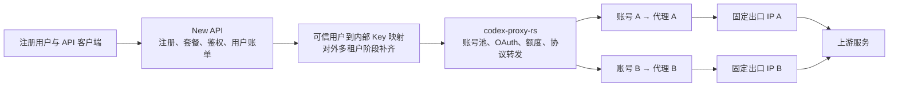

**ChatGPT／Codex 订阅账号分发网关：选型与二开调研**

> 历史研究，保留原审查时点和结论。当前开发任务以[单机 Docker 计划](../docs/PLAN.md)为准；原 P 编号见[历史对照](../docs/PLAN.md#legacy)。

> 范围更新（2026-11-22 UTC）：本报告是第一轮历史调研。用户随后明确为朋友小团队非商业自用，允许复用 Cockpit，并要求 Clash 订阅导入和 New API 统一管理员后台；下文商业售卖前提与对应优先级已被替代。当前要求以[项目需求](../docs/PROJECT.md)为准，实施建议见[架构与可行性](../docs/ARCHITECTURE.md)。固定提交的源码事实继续保留。

调研时间：2026-11-22，Asia/Shanghai。范围：公开 GitHub 仓库、固定提交源码、文档及许可证的静态核查。已使用三个子代理分别核查相似项目、New API 和 Cockpit；主代理核查 codex-proxy-rs 并整合架构。没有运行第三方项目、导入真实账号、支付或调用模型；下文的集成可行性需要 POC 验证。

本报告将目标理解为：管理员管理有权使用的上游 ChatGPT／Codex 账号，用户在自己的站点注册、购买平台套餐、取得平台 API Key，网关按权限和额度转发请求；每个上游账号绑定独立出口。平台用户、上游账号、平台套餐和上游订阅分别管理。Codex 订阅可用能力不等于完整 ChatGPT 网页产品，也不等于官方 API 余额。

**结论与选择**

已经找到高度相似的项目。Sub2API 覆盖账号池、代理、用户和计费的大部分目标；New API 自身也已有 Codex 订阅渠道。按用户已经选定的技术组合，建议保留 New API＋codex-proxy-rs，并使用后者现成的账号代理能力。

不建议把 Cockpit 的桌面代理模块作为第一阶段移植对象：codex-proxy-rs 当前已原生支持账号出站代理；Cockpit 的核心是外部 Mihomo 进程及其管理逻辑，另有非商业许可证限制。若已有 HTTP／HTTPS／SOCKS5 代理，直接配置即可；只有需要消费 Clash 订阅、VLESS 等节点时，才评估独立部署兼容内核。

本次查到的是可借鉴的实现，不能据此宣称任一项目已在本环境完成商业运行验收，也不能证明不存在更合适的私有或未检索到项目。

**找到的相似项目**

| 项目 | 已核实的能力 | 主要差距／限制 | 借鉴优先级 |
| --- | --- | --- | --- |
| [Sub2API](https://github.com/Wei-Shaw/sub2api) | Codex OAuth、账号池、账号代理、会话粘性、注册、用户 Key、订阅与支付履约、用量扣减 | 固定出口的故障关闭语义仍需验证；LGPLv3 与 README 商业运营声明需分别阅读 | 最接近整套替代，作为首个对照方案 |
| [CLIProxyAPI](https://github.com/router-for-me/CLIProxyAPI) | 多协议转发、Codex OAuth、账号代理、令牌刷新、轮转、额度冷却和可选会话亲和 | 核心未见完整自助订阅支付体系；当前主线不再内置用量统计；MIT | 协议和账号调度参考，可搭配外部售卖层 |
| [CLIProxyAPIPlus 公开分支](https://github.com/kaitranntt/CLIProxyAPIPlus) | 保留账号转发和内存用量聚合 | 用量统计不是支付／余额账本；主代理未独立深审该分支；MIT | 次要参考，避免因 Plus 名称误判能力 |
| [9Router](https://github.com/decolua/9router) | Codex OAuth、多账号与模型路由、connection proxy、额度及成本展示 | README 明确无 billing system；OAuth 刷新与推理出口一致性有缺口；MIT | 账号管理／路由界面参考，不优先作为售卖平台 |

Sub2API 固定于 [328db26f450edbdf9f8d4344a3ea903ac6396842](https://github.com/Wei-Shaw/sub2api/commit/328db26f450edbdf9f8d4344a3ea903ac6396842)，GitHub API 显示未归档，最近推送为 2026-11-21。这些能力也有实际源码支持：

- [注册路由](https://github.com/Wei-Shaw/sub2api/blob/328db26f450edbdf9f8d4344a3ea903ac6396842/backend/internal/server/routes/auth.go#L29-L56)和[用户接口](https://github.com/Wei-Shaw/sub2api/blob/328db26f450edbdf9f8d4344a3ea903ac6396842/backend/internal/server/routes/user.go#L82-L143)包含注册、登录、用户 Key CRUD、用量与订阅查询。
- [支付路由](https://github.com/Wei-Shaw/sub2api/blob/328db26f450edbdf9f8d4344a3ea903ac6396842/backend/internal/server/routes/payment.go#L39-L123)覆盖计划、订单、Stripe／支付宝／微信／EasyPay／Airwallex 回调；[履约服务](https://github.com/Wei-Shaw/sub2api/blob/328db26f450edbdf9f8d4344a3ea903ac6396842/backend/internal/service/payment_fulfillment.go#L568-L683)实际执行订阅分配和延期，不止是购买页面。
- [推理出口](https://github.com/Wei-Shaw/sub2api/blob/328db26f450edbdf9f8d4344a3ea903ac6396842/backend/internal/service/openai_gateway_forward.go#L1083-L1091)来自所选账号的 Proxy；[OAuth 服务](https://github.com/Wei-Shaw/sub2api/blob/328db26f450edbdf9f8d4344a3ea903ac6396842/backend/internal/service/openai_oauth_service.go#L339-L389)和[额度查询](https://github.com/Wei-Shaw/sub2api/blob/328db26f450edbdf9f8d4344a3ea903ac6396842/backend/internal/service/openai_quota_service.go#L517-L533)也有账号代理路径。读取代理失败后存在 proxyURL 留空分支，不能把“有代理字段”当作全链路禁止直连。
- [账号调度](https://github.com/Wei-Shaw/sub2api/blob/328db26f450edbdf9f8d4344a3ea903ac6396842/backend/internal/service/openai_account_scheduler.go#L497-L615)组合粘性、调度资格、并发槽和等待；[计费服务](https://github.com/Wei-Shaw/sub2api/blob/328db26f450edbdf9f8d4344a3ea903ac6396842/backend/internal/service/gateway_usage_billing.go#L357-L374)调用统一结算。Simple Mode 绕过完整 SaaS 账单，不适合拿来验证正式售卖模式。

其 [LICENSE](https://github.com/Wei-Shaw/sub2api/blob/328db26f450edbdf9f8d4344a3ea903ac6396842/LICENSE)全文为标准 LGPLv3，没有附加非商业条款；[README](https://github.com/Wei-Shaw/sub2api/blob/328db26f450edbdf9f8d4344a3ea903ac6396842/README.md#important-notice)同时声明作者未授权任何主体商业运营、相关活动与作者无关。应分别理解软件许可和作者商业背书，不能将其简单标成 NC 许可证，也不能据此宣称作者认可任何具体转售业务。正式选型时核清最终修改、分发方式和适用义务。

CLIProxyAPI 固定于 [f5c5681a8361c9da53e93c60b6507816eee7468b](https://github.com/router-for-me/CLIProxyAPI/commit/f5c5681a8361c9da53e93c60b6507816eee7468b)，未归档，最近推送为 2026-11-21。[路由](https://github.com/router-for-me/CLIProxyAPI/blob/f5c5681a8361c9da53e93c60b6507816eee7468b/internal/api/server_routes.go#L68-L95)实际注册 Messages、Responses HTTP 和 WS；[代理选择](https://github.com/router-for-me/CLIProxyAPI/blob/f5c5681a8361c9da53e93c60b6507816eee7468b/internal/runtime/executor/helps/proxy_helpers.go#L22-L60)优先执行级 override、账号 ProxyURL、全局代理；[Codex 刷新](https://github.com/router-for-me/CLIProxyAPI/blob/f5c5681a8361c9da53e93c60b6507816eee7468b/internal/runtime/executor/codex_executor_auth.go#L340-L349)传入账号 ProxyURL。[会话亲和配置](https://github.com/router-for-me/CLIProxyAPI/blob/f5c5681a8361c9da53e93c60b6507816eee7468b/config.example.yaml#L177-L229)默认关闭。请求级覆盖和客户端初始化失败回退需要纳入固定出口验证。[MIT 许可](https://github.com/router-for-me/CLIProxyAPI/blob/f5c5681a8361c9da53e93c60b6507816eee7468b/LICENSE)适合代码参考，但统计和计费仍要区分。

Plus 检索边界：本次 `router-for-me/CLIProxyAPIPlus` 的公开 API 返回 404，不能由此断言它已删除；核实到的是 kaitranntt 的公开分支 [0341bcc440583738d7d0e673abefc63bbe99e131](https://github.com/kaitranntt/CLIProxyAPIPlus/commit/0341bcc440583738d7d0e673abefc63bbe99e131)，最近推送为 2026-11-06。[统计实现](https://github.com/kaitranntt/CLIProxyAPIPlus/blob/0341bcc440583738d7d0e673abefc63bbe99e131/internal/usage/logger_plugin.go)为 API／模型维度内存聚合，[许可](https://github.com/kaitranntt/CLIProxyAPIPlus/blob/0341bcc440583738d7d0e673abefc63bbe99e131/LICENSE)为 MIT，不构成完整客户账本。

9Router 固定于 [1855aa44473e88feac9d3f131b9c0c5fc9706b68](https://github.com/decolua/9router/commit/1855aa44473e88feac9d3f131b9c0c5fc9706b68)，未归档，最近推送为 2026-11-16。[README](https://github.com/decolua/9router/blob/1855aa44473e88feac9d3f131b9c0c5fc9706b68/README.md)明确成本仅为估算、没有 billing system；[代理请求](https://github.com/decolua/9router/blob/1855aa44473e88feac9d3f131b9c0c5fc9706b68/open-sse/utils/proxyFetch.js#L549-L589)在 strictProxy 关闭时允许故障直连；[Codex 刷新](https://github.com/decolua/9router/blob/1855aa44473e88feac9d3f131b9c0c5fc9706b68/open-sse/services/tokenRefresh/providers.js#L257-L272)没有账号代理参数。连续 N 次轮转也不等于可靠的账号会话亲和。[MIT 许可](https://github.com/decolua/9router/blob/1855aa44473e88feac9d3f131b9c0c5fc9706b68/LICENSE)不能弥补这些产品能力差距。

近期推送只说明维护活动，不能据此认定代码稳定或满足商业容量。本次未用 stars 数量作选型依据。

**codex-proxy-rs：独立出口已经实现**

固定审查提交：[58cbb607505dda4a1cee6e01b9f76e267ad3c261](https://github.com/zyycn/codex-proxy-rs/commit/58cbb607505dda4a1cee6e01b9f76e267ad3c261)。调研时最新公开稳定发行版为 [v3.54.2](https://github.com/zyycn/codex-proxy-rs/releases/tag/v3.54.2)。本报告的详细能力对应上述 main 提交，不能自动视为所有历史版本或发行镜像的能力。

| 核查项 | 当前实现与证据 | 对方案的影响 |
| --- | --- | --- |
| 代理类型 | [账号代理值对象](https://github.com/zyycn/codex-proxy-rs/blob/58cbb607505dda4a1cee6e01b9f76e267ad3c261/backend/crates/gateway-core/src/account/proxy.rs#L18-L36) 接受 HTTP、HTTPS、SOCKS5、SOCKS5H | 普通代理地址无需额外内核 |
| 绑定与管理 | [Managed Proxies API](https://github.com/zyycn/codex-proxy-rs/blob/58cbb607505dda4a1cee6e01b9f76e267ad3c261/docs/api.md#L1443-L1542) 提供代理 CRUD、探测、关联账号、出口 IPv4／IPv6；账号通过 outboundProxyId 绑定 | 复用现有数据模型和后台，避免再造一份代理表 |
| HTTP 出站 | [gateway-egress](https://github.com/zyycn/codex-proxy-rs/blob/58cbb607505dda4a1cee6e01b9f76e267ad3c261/backend/crates/gateway-egress/src/lib.rs#L67-L116) 优先显式代理；缺省按目标和环境变量选路 | HTTP_PROXY 等全局变量只适合部署默认，不能代替账号绑定 |
| 连接隔离 | [HTTP client](https://github.com/zyycn/codex-proxy-rs/blob/58cbb607505dda4a1cee6e01b9f76e267ad3c261/backend/crates/providers/openai/src/transport/client.rs#L56-L110) 以账号 ID、出口和 CA／超时配置构成缓存键；[for_account](https://github.com/zyycn/codex-proxy-rs/blob/58cbb607505dda4a1cee6e01b9f76e267ad3c261/backend/crates/providers/openai/src/transport/client.rs#L879-L906) 装配账号出口及 WS 连接身份 | 已有按账号／出口隔离连接的实现 |
| WebSocket | [握手拨号](https://github.com/zyycn/codex-proxy-rs/blob/58cbb607505dda4a1cee6e01b9f76e267ad3c261/backend/crates/providers/openai/src/transport/websocket/handshake.rs#L285-L355) 使用账号代理；SOCKS5 与 SOCKS5H 分别处理本地／远端 DNS | 不止覆盖普通 HTTP；需将 WS 纳入实际联调 |
| Token 刷新 | [refresh_with_proxy](https://github.com/zyycn/codex-proxy-rs/blob/58cbb607505dda4a1cee6e01b9f76e267ad3c261/backend/crates/providers/openai/src/credential/refresh.rs#L307-L316) 传入账号出口 | 刷新不必另写一套网络客户端 |
| OAuth 服务端交换 | [授权完成](https://github.com/zyycn/codex-proxy-rs/blob/58cbb607505dda4a1cee6e01b9f76e267ad3c261/backend/crates/providers/openai/src/credential/oauth.rs#L497-L568) 使用已有账号或待授权记录的出口 | 应在授权开始前选定出口 |
| 额度、目录和资料 | [出口合同](https://github.com/zyycn/codex-proxy-rs/blob/58cbb607505dda4a1cee6e01b9f76e267ad3c261/docs/architecture.md#L1051-L1083) 覆盖账号辅助请求；源码对应调用 for_account | 可复用，但最终仍要抓取请求路径验证 |
| 客户端协议 | [数据面合同](https://github.com/zyycn/codex-proxy-rs/blob/58cbb607505dda4a1cee6e01b9f76e267ad3c261/docs/api.md#3-模型数据面与模型目录) 包含 Responses HTTP／SSE／WS、Chat Completions、Messages、Images 等 | MVP 优先验证 Responses，减少同时转换多种协议的变量 |

普通 HTTP／SOCKS 代理和账号绑定的实现可按 CPR 的 [Apache-2.0 许可证](https://github.com/zyycn/codex-proxy-rs/blob/58cbb607505dda4a1cee6e01b9f76e267ad3c261/LICENSE)复用，分发时保留许可、归属声明并标明修改。它对商业二开的许可条件与 Cockpit 不同。

最需要改的现有行为是“禁用／删除代理后的默认出口”。[Store 的账号投影](https://github.com/zyycn/codex-proxy-rs/blob/58cbb607505dda4a1cee6e01b9f76e267ad3c261/backend/crates/gateway-store/src/postgres/provider_accounts/rows.rs#L423-L431) 会过滤禁用代理，结果成为无显式代理；随后 gateway-egress 使用部署默认代理，或者直连。删除代理还会解除账号绑定。显式代理连接失败本身会报错，不能把这两种情况混为一谈。

因此，“固定出口”应增加一项明确业务约束：必须绑定出口的账号，在代理缺失、被禁用或删除时停止相关出站操作；账号推理、OAuth 交换、令牌刷新、额度、目录和资料请求都遵守同一决定。仅在调度器里跳过账号不足以阻止后台刷新走默认出口。修改位置应复用 Store／Admin 的绑定事实及 Provider／egress 的网络边界，不复制第二个账号池。

两个代理 URL、端口或节点名不同，不能证明公网出口不同。若要一账号一 IP，需要代理服务自身提供稳定且不同的公网出口，并对 IPv4、IPv6、重连和重启后结果验收。软件不会自动生成独立公网 IP。

浏览器访问 OAuth 授权页的出口由浏览器／终端网络决定，服务端代理只约束服务端请求。若要求首次登录也使用相同出口，需要单独设计授权工作站的网络路径。

**New API：可复用的商业前台与接入边界**

固定审查提交：[8542c9d6490b4330fe18160930f81ae7428bc777](https://github.com/QuantumNous/new-api/commit/8542c9d6490b4330fe18160930f81ae7428bc777)，2026-11-20 18:30:29 UTC。

已核实[用户注册](https://github.com/QuantumNous/new-api/blob/8542c9d6490b4330fe18160930f81ae7428bc777/controller/user.go#L217-L329)、[用户 Token 配置](https://github.com/QuantumNous/new-api/blob/8542c9d6490b4330fe18160930f81ae7428bc777/model/token.go#L14-L35)、[分组／渠道选择](https://github.com/QuantumNous/new-api/blob/8542c9d6490b4330fe18160930f81ae7428bc777/model/channel_cache.go#L123-L219)、[套餐有效期与额度重置](https://github.com/QuantumNous/new-api/blob/8542c9d6490b4330fe18160930f81ae7428bc777/model/subscription.go#L157-L201)及[钱包／套餐扣费顺序](https://github.com/QuantumNous/new-api/blob/8542c9d6490b4330fe18160930f81ae7428bc777/service/billing_session.go#L388-L489)。这些可以直接作为产品基础，无需重建注册和账单系统。

New API 已有原生 Codex 渠道 type 57，接收 OAuth JSON 并刷新令牌。[自动刷新任务](https://github.com/QuantumNous/new-api/blob/8542c9d6490b4330fe18160930f81ae7428bc777/service/codex_credential_refresh_task.go#L18-L120)每 10 分钟扫描、提前 24 小时刷新，跳过多 Key 渠道；[刷新请求](https://github.com/QuantumNous/new-api/blob/8542c9d6490b4330fe18160930f81ae7428bc777/service/codex_credential_refresh.go#L42-L66)使用渠道 Proxy。当前已读代码中未找到内置的 Codex 浏览器授权和 code exchange；前端要求导入 JSON，并限制 Codex 批量创建。外部插件是否补足此功能未核查。

如果账号量较小，能接受手工导入，**一个账号＝一个 Codex 渠道＝一个代理**值得作为最省组件的对照。多 Key 共用一渠道会共用代理，且该自动刷新任务跳过多 Key，不适合作为本需求的独立出口方案。渠道负载均衡也不能直接当作已验证具备 CPR 全部账号健康和运维能力。

当使用 CPR 时，配置边界如下：

| 配置项 | 建议／现有源码行为 |
| --- | --- |
| New API 渠道类型 | 普通 OpenAI 兼容渠道，type 1 |
| Base URL | CPR 服务根地址，如 `http://codex-proxy-rs:PORT`；按此渠道的 URL 拼接规则不附加 `/v1` |
| 渠道凭据 | CPR Client Key；内部 POC 可静态配置，正式多租户改为可信映射 |
| Responses | 入口 `POST /v1/responses`，下游和 CPR 之间保持相同路径 |
| WebSocket | `GET /v1/responses` 升级，并启用该渠道的 `responses_websocket_enabled` |
| Channel Proxy | 只控制 New API 到 CPR 的网络路径；账号到 OpenAI 的出口由 CPR 选择 |

依据：[OpenAI 渠道 URL 与鉴权](https://github.com/QuantumNous/new-api/blob/8542c9d6490b4330fe18160930f81ae7428bc777/relay/channel/openai/adaptor.go#L178-L240)、[路径直接拼接](https://github.com/QuantumNous/new-api/blob/8542c9d6490b4330fe18160930f81ae7428bc777/relay/common/relay_utils.go#L26-L37)、[WS 渠道开关](https://github.com/QuantumNous/new-api/blob/8542c9d6490b4330fe18160930f81ae7428bc777/model/channel_constraint.go#L127-L144)。原生 Codex type 57 的[专用适配器](https://github.com/QuantumNous/new-api/blob/8542c9d6490b4330fe18160930f81ae7428bc777/relay/channel/codex/adaptor.go#L141-L199)会改用 ChatGPT 专用路径和 OAuth 凭据，不适用于连接 CPR。

**用户隔离是必须补齐的集成职责。**普通 OpenAI 渠道会把所有该渠道请求换成同一渠道 Key；[默认 header 初始化](https://github.com/QuantumNous/new-api/blob/8542c9d6490b4330fe18160930f81ae7428bc777/relay/channel/api_request.go#L52-L64)不自动传递可信用户身份。客户端可传 previous_response_id、prompt_cache_key、user 等字段；[默认亲和规则](https://github.com/QuantumNous/new-api/blob/8542c9d6490b4330fe18160930f81ae7428bc777/setting/operation_setting/channel_affinity_setting.go#L52-L137)还会透传若干 session/thread/Codex headers，因此不能说这些字段全被丢弃。但[亲和缓存键](https://github.com/QuantumNous/new-api/blob/8542c9d6490b4330fe18160930f81ae7428bc777/service/channel_affinity.go#L339-L351)没有包含已认证用户／Token ID，路由亲和不等于租户授权。

CPR 的[续接与会话合同](https://github.com/zyycn/codex-proxy-rs/blob/58cbb607505dda4a1cee6e01b9f76e267ad3c261/docs/architecture.md#L695-L748)按 Client Key 隔离会话、账号范围和 continuation。全站共享 CPR Key 会合并 CPR 看到的主体；每套餐 Key 也只隔离套餐。New API 自己的用户账单仍然可以独立，但 CPR 层无法据一个公共 Key 区分前台用户。这是设计边界，不是本次已复现跨用户数据泄漏。

建议通过已认证 New API 用户 ID 和授权范围选择内部 CPR Key，保存受保护的映射，剥离客户端伪造的内部身份信息。用户续费、转组、封禁和 Key 撤销均需同步策略；不要把原始 ChatGPT token 暴露给注册用户，也不要用客户端自报的 user/session 字段决定权限。

计量方面，[Responses usage accumulator](https://github.com/QuantumNous/new-api/blob/8542c9d6490b4330fe18160930f81ae7428bc777/service/responses_usage.go#L14-L171)读取终态 response.usage，也可能在缺失时基于已收文本、工具和推理 delta 估算 Token。因此不能承诺所有账单都来自完整的上游实际用量。[SSE 结束路径](https://github.com/QuantumNous/new-api/blob/8542c9d6490b4330fe18160930f81ae7428bc777/relay/channel/openai/relay_responses.go#L69-L104)在中断后结束计量并继续消费结算；[WS 建连和绑定](https://github.com/QuantumNous/new-api/blob/8542c9d6490b4330fe18160930f81ae7428bc777/relay/responses_websocket.go#L325-L379)与后续断开结算是不同阶段。要分别实测完整流、中断、取消和建连失败，不能用 HTTP 200 或已开始 SSE 代表完成成功。

许可方面，New API 为 **AGPLv3**，允许商业使用。[第 13 条](https://github.com/QuantumNous/new-api/blob/8542c9d6490b4330fe18160930f81ae7428bc777/LICENSE#L540-L559)要求修改版提供远程网络交互时向相关用户显著提供免费获取该运行版本对应源码的机会；仅指向上游仓库不能代替提供自己的修改。[NOTICE](https://github.com/QuantumNous/new-api/blob/8542c9d6490b4330fe18160930f81ae7428bc777/NOTICE#L9-L25)还要求保留贡献者署名、修改说明和可见的原项目链接。把它做品牌外壳仍应保留这些要求；若要不同授权条件，需要另行取得许可，不能假定当前已获豁免。

**Cockpit：可借鉴的设计与不宜移植的部分**

固定审查提交：[c004bf71be250cc2536fc91ef90638837f0013a0](https://github.com/jlcodes99/cockpit-tools/commit/c004bf71be250cc2536fc91ef90638837f0013a0)，2026-11-18，宿主版本 1.4.2。

[第三方内核记录](https://github.com/jlcodes99/cockpit-tools/blob/c004bf71be250cc2536fc91ef90638837f0013a0/docs/third-party/mihomo-v1.19.33.md#L1-L19)指向外部 Mihomo v1.19.33；由用户下载或导入后作为独立进程运行。这里的“内核”是网络代理引擎，不是操作系统内核。它的[配置生成](https://github.com/jlcodes99/cockpit-tools/blob/c004bf71be250cc2536fc91ef90638837f0013a0/src-tauri/src/modules/codex_proxy_engine.rs#L718-L738)使用本地 mixed-port，关闭 TUN 和全局接管。

有价值的设计是[每账号稳定的 SOCKS5／HTTP CONNECT 入口](https://github.com/jlcodes99/cockpit-tools/blob/c004bf71be250cc2536fc91ef90638837f0013a0/src-tauri/src/modules/codex_proxy_desktop_router.rs#L1-L20)：端口归账号持久保存，新连接使用当前绑定，旧连接持有原引擎租约。该入口只承接 TCP，不能推导 UDP／QUIC 全覆盖。

[账号代理规则](https://github.com/jlcodes99/cockpit-tools/blob/c004bf71be250cc2536fc91ef90638837f0013a0/src-tauri/src/modules/codex_account_proxy.rs#L47-L136)针对普通 Codex OAuth 账号，按账号绑定、统一代理、调用方默认出口选择。它并非任意账号类型的统一服务器代理库。[节点解析](https://github.com/jlcodes99/cockpit-tools/blob/c004bf71be250cc2536fc91ef90638837f0013a0/src-tauri/src/modules/codex_proxy_node_parser.rs#L358-L377)支持 VMess、Shadowsocks、VLESS、Trojan、Hysteria2／Hy2、TUIC 等链接，复杂节点转交外部引擎。

覆盖边界值得借鉴：[账号感知刷新](https://github.com/jlcodes99/cockpit-tools/blob/c004bf71be250cc2536fc91ef90638837f0013a0/src-tauri/src/modules/codex_oauth.rs#L1735-L1779)传入账号才能进入账号代理 builder；通用无账号调用仍有默认路径。[授权 WebView](https://github.com/jlcodes99/cockpit-tools/blob/c004bf71be250cc2536fc91ef90638837f0013a0/src-tauri/src/modules/codex_oauth.rs#L803-L875)也存在平台限制，不能用服务端 token exchange 的出口保证外部浏览器出口。已绑定代理故障可返回错误，但“禁用代理”明确可能直连；这同样不满足严格固定出口的默认要求。

移植边界：没有现成独立 Rust crate 可直接嵌入；相关模块耦合 Tauri runtime、账号存储、节点和订阅解析、引擎安装／更新、日志及生命周期。为了 HTTP／SOCKS 账号绑定而移植这些模块，收益低于复用 CPR 的现成出站层。桌面账号切换、系统配置和浏览器 WebView 不属于服务器 MVP。

[README 的许可声明](https://github.com/jlcodes99/cockpit-tools/blob/c004bf71be250cc2536fc91ef90638837f0013a0/README.md#L515-L521)为 **CC BY-NC-SA 4.0**，明确要求企业内部商业用途、对外商业服务、付费集成及二次售卖另获书面商业授权。商业项目不能把它当作宽松许可代码直接复制。Mihomo 是独立项目，其 [GPLv3 许可证](https://github.com/MetaCubeX/mihomo/blob/v1.19.33/LICENSE)义务应按最终使用／分发方式单独核对；进程分离本身不是免除许可义务的结论。

**建议部署关系**

图中的 Key 映射是需要实现和验证的集成职责，可以放入 New API 的转发适配层；不要求新增独立微服务。对用户只开放 New API；Rust 数据面只允许可信网关访问，管理面单独限制访问。

| 数据／决定 | 权威归属 | 约束 |
| --- | --- | --- |
| 用户身份、登录、用户 API Key、套餐、余额、订单、最终扣费 | New API | CPR 的用量与估算费用用于账号运营、对账或容量保护，不维护第二份用户钱包 |
| 上游账号、OAuth 凭据、刷新、账号额度与可用状态 | codex-proxy-rs | 避免把同一份刷新令牌交给两个后端同时自动续期 |
| 账号到出口绑定与代理状态 | codex-proxy-rs 原有代理管理 | 必须出口的账号应失败即停止；变更绑定有审计 |
| New API 用户／权限范围到 CPR Client Key 的对应关系 | 集成适配层 | 由已认证服务端身份查映射，不信任客户端自报用户头 |
| 实际公网 IP、节点协议和连接 | 代理服务；必要时独立内核 | 接入端口固定，最终出口也须固定；订阅更新不能无声重绑 |

如使用已有普通代理，链路为 `账号 → outboundProxyId → HTTP/SOCKS5 代理 → 上游`。如使用复杂节点，链路为 `账号 → outboundProxyId → 内核专属入站端口 → 固定节点 → 上游`。每个端口必须锁定对应节点；共享自动选择组、随机节点或自动直连回退会破坏固定出口目标。容器部署时使用可达的服务地址；容器内 127.0.0.1 只指向该容器，除非明确共享网络命名空间。

下游用户默认可以共享一个有权限的账号池，“上游账号独立 IP”不等于“每个注册用户独占一个 ChatGPT 账号”。若以后售卖独享账号，应通过账号分组、用户权限范围和容量预留单独实现，避免混入共享套餐。

**二开顺序与验收条件**

由于已找到类似项目，第一阶段以复用和对比验证为主。以下是保留 New API＋Rust 技术组合时的工作计划，不代表已开始实施。

| 阶段 | 工作内容 | 完成条件 |
| --- | --- | --- |
| 0. 选型对照 | 固定版本与许可证；用同一套小样本比较 New API 直连 Codex、New API＋CPR、Sub2API | 对实际客户端、账号数量、代理类型和是否要独享做出选择；不以 README 功能数量替代验收 |
| 1. 最小链路 | 两个获授权测试账号、两个独立固定出口、两个测试用户；先跑 Responses HTTP／SSE，再跑 Responses WS | 鉴权、模型列表、工具调用、长流、多轮请求能够完成；账号 A／B 的推理和刷新分别走指定 IP |
| 2. 固定出口约束 | 复用原有代理记录与绑定；加入必须出口策略；处理代理禁用、删除、配置变更和后台任务 | 停代理、删代理、认证失败或重启后，无账号流量意外直连；绑定与连接池不串用；仅停调度不足以算通过 |
| 3. 多用户隔离 | 服务端按 New API 用户和授权范围映射内部 CPR Key；配置模型、账号分组、并发与限流 | 两个用户提交同名 session、thread、cache key 时不串状态；用户 B 不能续接用户 A 的 response；伪造头无效 |
| 4. 商业计量 | New API 统一订阅、充值、扣费与对账；定义输入、输出、缓存和推理用量口径 | 非流、完整流、流中断、上游 401／429／5xx、重试、客户端取消均有明确账单结果；重复通知不重复履约 |
| 5. 运维与小流量试用 | 日志脱敏、账号容量观测、代理探测、备份恢复、故障演练和版本回滚 | 可定位一条用户请求到账号和代理；恢复后绑定／订单／余额一致；在明确容量范围内试用 |

不需要一开始重写注册、支付、普通代理客户端或模型协议适配。优先新增的业务能力是固定出口约束、可信用户映射及必要的网关联调。

两层网关各自都有重试逻辑，必须明确所有权：账号刷新和账号级恢复由 CPR 负责；New API 的跨渠道重试应结合是否已发出请求、是否已交付流、是否已有工具副作用决定。POC 可先限制外层重试，避免重复放大。读取失败或中断不能直接解释为上游未执行；流中断账单需依有无可信 usage 及产品规则处理，不能默认为完整成功或一律零费用。

商业用户账单、CPR 估算金额和上游订阅限额是三种口径。订阅包含额度不能直接换算成固定数量的官方 API 美元余额；套餐价格应以实测可供容量和故障余量制定，不能用单个账号的一次短测试承诺长期吞吐。

**容量、数据和授权边界**

- CPR 的[运行与状态合同](https://github.com/zyycn/codex-proxy-rs/blob/58cbb607505dda4a1cee6e01b9f76e267ad3c261/docs/architecture.md#8-状态所有权)包含进程内队列和会话状态；[生命周期说明](https://github.com/zyycn/codex-proxy-rs/blob/58cbb607505dda4a1cee6e01b9f76e267ad3c261/docs/architecture.md#L1346-L1379)明确单副本边界，并指出账号凭据以明文 Provider JSON 保存在 PostgreSQL。数据库、备份和恢复材料须按敏感数据保护；加密凭据是进一步强化项，不能宣称当前已具备。
- 使用 Redis 不等于 CPR 已支持无状态多副本。初期保持单副本；需要扩容时先测瓶颈，可按独立账号池分片，各片保持明确状态归属，不能直接共享同一状态库横向复制。
- 账号健康、代理健康和上游额度是不同事实。代理探测成功只证明该探测目的可达，不能证明 OAuth／Codex 端点可达，也不证明账号还有额度。节点管理、探测和 DNS 策略不能以关闭证书校验换取成功。
- 开源代码许可与上游服务使用许可分别成立。[OpenAI 的 Codex 订阅说明](https://help.openai.com/en/articles/11369540-using-codex-with-your-chatgpt-plan)说明使用 ChatGPT 登录 Codex 时适用对应服务条款；[个人服务条款](https://openai.com/policies/terms-of-use/)限制账号向他人开放、转售／分发服务和规避限额。计划中的商业订阅分发与这些条款存在直接关系，应先确认适用合同和授权；独立出口 IP 不改变此关系，也不能保证账号不受限制。官方 API 或明确获准的服务合同可以保留为同一网关的上游来源。

**本次验证范围**

完成：仓库发现、主要候选源码核查、固定提交记录、账号代理调用链、New API 渠道与用户身份边界、Cockpit 的内核管理和许可边界、可实施的阶段划分。

未执行：构建／自动化测试、真实 OAuth 授权或刷新、两账号两出口验证、New API 与 CPR 端到端对接、支付回调、容量和故障压测。因此，本报告给出的是有源码依据的选型和设计结论，不是部署成功或生产就绪证明。
